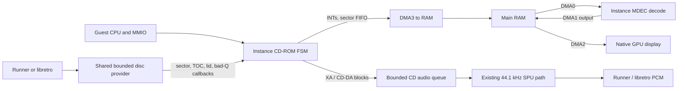

<user_constraints>
## User Constraints (from CONTEXT.md)

### Locked Decisions

### CD-ROM timing and command behavior
- Follow DEC.44's deterministic CPU-cycle model: 451,584 cycles per 1x sector, fixed documented response times, and the integer square-root seek model in 1/75-second ticks. Do not add random seek jitter, host-clock timing or speed-up behavior.
- Follow DEC.45 and DEC.47 for region/licence answers, lid-open INT5, command/interrupt sequencing, ADPCM-before-data delivery, and the bounded sector-buffer visibility rules.
- Keep uncertain silicon timing claims distinct from the selected baseline. The fixture and pinned logs test their named behavior; a later measured-accuracy pass can revisit the seek curve with new hardware evidence.

### Disc interface and supported images
- Keep file access and hostile image parsing outside the deterministic core. The host supplies sectors and TOC through `schway_disc` callbacks, including lid, swap and bad-Q behavior; only run calls may request sectors.
- Implement one shared host helper for cue/bin, ISO and m3u. Apply the hostile-input bounds and path containment rules in PER 7; refuse `.chd`, `.pbp`, `.ecm` and `.ccd` with the named unsupported-media status/message.
- Add only the public disc API needed by these consumers, following DEC.75's per-phase API growth and keeping API v1-v4 callers covered. Use the owned fixture's `bad_q` data to exercise the callback without broadening the v1 image parser into a general SBI/LibCrypt feature.
- For m3u in libretro, use `SET_DISK_CONTROL_EXT_INTERFACE`: eject opens the lid, insert swaps the selected image and TOC, and a closed lid rejects `schway_swap_disc`. Do not add a second legacy control surface without a named requirement.

### XA and CD-DA audio
- Feed sector-decoded XA and CD-DA through a bounded queue into the existing 44.1 kHz SPU output path; underflow produces silence. Preserve the fixed 768-cycle SPU sample cadence and the runner/libretro PCM equality contract.
- Use DEC.39's integer seven-phase, 29-tap XA resampler and reset its six-step phase to zero at power-on. Keep XA history across sectors, apply the ATV matrix and SPU AVOL at the documented point, and continue audio work when the SPU output is muted.
- Test XA and CD-DA independently and together. Resolve routine playback details such as double-speed CD-DA consumption in focused tests; do not reopen the selected resampler without a hardware capture that supports the alternative.

### MDEC, fixture and evidence
- Use DEC.33's integer two-pass IDCT, int16 Q14 scale table, Q16 color coefficients and 1,000-cycle block cost baseline. Hash raw MDEC output before DMA1 reordering; require exact 4-bit/8-bit reference blocks and the documented ±1 per-channel frame/movie tolerance.
- Wire the FMV path through CD DMA3 → RAM → MDEC DMA0 → RAM via DMA1 → GPU DMA2, then verify native 24-bit display output. Fetch and run each pinned real oracle as soon as its first caller works; keep direct block tests as fast arithmetic and malformed-input checks, not a replacement for hardware references.
- Build `disc_boot` in the build tree from owned sources with mkpsxiso. Keep it under the 512 KiB build cap, keep its generated image out of git and release archives, and include no BIOS, Sony licence material or commercial bytes.
- Keep every behavior test in the exact inventory and CI; reserve pinned ps1-tests reference comparisons for their intended nightly lane. The hosted RetroArch smoke runs in the background and compares its image with the runner's output.

### Folded Todos
- **Select the 40-clock CD-ROM DMA cost:** connect the device delay setting to DMA channel 3 and test the documented 24- and 40-cycle cases when the CD-ROM device endpoint is implemented.
- **Add the vendored-file digest check:** add `libretro.vendored` in the plan that vendors the pinned rcheevos `rc_hash_disc.c` used for the disc identity hash; retain its notice and a negative control.

### the agent's Discretion
- Choose private struct fields, module helper boundaries, test-file splits, plan waves and routine values not constrained above. Keep changes small and per-chip, with all mutable machine state in the instance.
- The MDEC status log has no cycle stamps, and the seek curve has low confidence; report those evidence limits accurately rather than treating deterministic regression hashes as hardware proof.

### Deferred Ideas (OUT OF SCOPE)
- CHD, PBP, ECM, CCD and full SBI/LibCrypt media support remain in v2.0 as settled by DEC.43.
- Refit CD seek timing, MDEC block cost, XA resampler rounding or other hardware-only unknowns in the measured-accuracy horizon only when new hardware evidence is available.
- Browser disc playback, save states, rewind, run-ahead, movies and unrelated peripherals stay in their later milestones.
</user_constraints>

<phase_requirements>
## Phase Requirements

| ID | Description | Research Support |
|----|-------------|------------------|
| DISC-01 | `ctest -L disc` runs the CD-ROM controller FSM in cycles only: fixed acknowledge 50,000, Init second response 476,000, Pause 2,170,000 >> speed (7,666 when paused), INT1 every 451,584 >> speed, the integer square-root seek model in 1/75 s ticks, the firmware delivery order (ADPCM first, INT1 only when no INT is pending, at most one undelivered INT1), the sector buffer exposing only the oldest and newest sector, GetID answered from the profile region against the licence string, the unsolicited INT5 on lid open; the nightly lane compares the ps1-tests `cdrom/timing` and `getloc` logs; `fuzz.regress.cdrom` replays its seeds. | Core device/scheduler/DMA seams, pinned timing/Getloc logs, state ownership and first-caller oracle order below. `[VERIFIED: .planning/REQUIREMENTS.md:81]` |
| DISC-02 | `host/disc_image.c` parses cue/bin (MODE1/2048, MODE2/2352, AUDIO), iso and m3u with the PER 7 bounds behind the `schway_disc` callbacks, refuses `.chd`, `.pbp`, `.ecm` and `.ccd` with "unsupported: CHD (planned v2.0)" style messages and exit 77, with `fuzz.cue`, `fuzz.cnf` and `fuzz.m3u` nightly and `fuzz.regress.cue`, `fuzz.regress.cnf` and `fuzz.regress.m3u` replaying their seeds per leg; the `disc_boot` fixture (one mkpsxiso v2.30 image under 512 KiB from a committed XML, built on every leg and never committed: the own PS-EXE, a Form2 XA track at 37.8 kHz stereo, a short STR, one generated CD-DA tone track, a Redump-style cue and a hand-written `.sbi`) boots through OpenBIOS from `SYSTEM.CNF` (`BOOT = cdrom:\SWAY.EXE;1`), reads 16 sectors with ReadN into a CRC-32 record, records GetID/GetTN/GetTD, plays the XA track and the CD-DA track; `boots@600`, `mailbox@900`, `audio@900` and `frame@900` are pinned and identical on every platform that runs it; the vendored rcheevos `rc_hash_disc.c` (MIT, `dfdc64ea035c`) CTest compares the MD5 on `disc_boot`; if OpenBIOS requires licence sectors, the fixture XML carries an own-authored placeholder licence area (never Sony bytes) and the requirement is met with it. | Shared host-only provider, parser bounds/fuzzing, deterministic owned image build, license audit and vendored digest check. `[VERIFIED: .planning/REQUIREMENTS.md:82]` |
| DISC-03 | `ctest -L mdec` decodes MDEC blocks with the integer two-pass IDCT (int16 Q14 scale table, ares rounding, Q16 colour coefficients) at 1000 cycles per block into 4/8/15/24-bit output for DMA1, and the nightly lane compares the ps1-tests `mdec` references with a fixed tolerance: bit-exact for the IDCT reference blocks (4-bit and 8-bit); STR frames (`frame` and `movie`) within ±1 per channel; the decoded-frame hash is over the raw output words before DMA1 reordering; the STR on `disc_boot` plays through DMA3 to DMA0 to DMA1 to DMA2 into the 24-bit display path; `fuzz.regress.mdec` replays its seeds. | Core MDEC/DMA/GPU path, verified pinned MDEC block and status logs, and first-caller oracle sequence below. `[VERIFIED: .planning/REQUIREMENTS.md:83]` |
| DISC-04 | The libretro `SET_DISK_CONTROL_EXT_INTERFACE` (`set_initial_image`, `get_num_images`, `replace_image_index`, `get_image_path`, `get_image_label`) drives an m3u of two own images: eject opens the lid as the controller reports it and raises INT5, insert installs the new TOC, and `libretro.host` shows the TOC change; `schway_swap_disc` with the lid closed returns `ERR_LID_CLOSED` and changes nothing; the runner's `--inputs` control lines open, swap and close the lid in the `disc_boot` `press@300` movie; the hosted RetroArch session boots `disc_boot` through the CI-built OpenBIOS from `system/` and its screenshot matches the runner's `--png` frame; the `examples/sdl2/` host (one file, about 300 lines) builds against the installed library and is never packaged or tested beyond building; `core.no_busy_loop` proves an idle drive costs a fixed Ir bound. | Append-only API revision, libretro ext disk control, shared provider in both hosts, OpenBIOS fixture and idle scheduler bound. `[VERIFIED: .planning/REQUIREMENTS.md:84]` |
</phase_requirements>

# Phase 6: Discs and FMV - Research

**Researched:** 2026-11-15
**Domain:** Deterministic PS1 CD-ROM, disc-image hosting, XA/CD-DA, MDEC and FMV integration
**Confidence:** MEDIUM overall (implementation seams and pins are high confidence; seek and some timing claims remain low confidence)

## Summary

Keep a hard boundary between host image handling and the integer-only machine core. Add instance-owned CD-ROM and MDEC devices that use the existing bus, DMA, scheduler, state visitor and SPU/GPU interfaces; add one shared host disc provider for the runner and libretro. Build `disc_boot` only in the build tree from owned sources. No runtime library package is needed. `[CITED: .planning/phases/06-discs-and-fmv/06-CONTEXT.md; .planning/preparation/ARCHITECTURE.md §§1–5,10–11]`

The highest-value planning order is caller-first: establish the subsystem targets and exact inventories, bring up CD register access and MDEC block access with their pinned reference cases at the first runnable point, then wire DMA/audio/video and host boot/swap flows. Run the pinned `ps1-tests` executables in their nightly lane as soon as each real case has a caller; don't let the owned `disc_boot` regression become the only evidence. `[CITED: .planning/AUTONOMOUS.md; .planning/LESSONS.md SW-ORACLE-001; .planning/phases/06-discs-and-fmv/06-CONTEXT.md]`

The current tree already has integration seams but no working disc or MDEC endpoint: CD-ROM and MDEC MMIO routes are recorded as unbuilt accesses, DMA0/1/3 use stub endpoints, and the scheduler only folds in DMA, timers, GPU, SIO and SPU. The public header is API v4 and the `.info` currently advertises `disk_control = "false"`. The research therefore recommends a new additive API revision with preserved API v1–v4 consumers. `[VERIFIED: src/bus.c:594-614; src/dma.c:349-386; src/sched.c:28-69; include/schwaystation.h:14; libretro/schwaystation_libretro.info.in:25]`

**Primary recommendation:** split by real caller and per-chip inventory: CD-ROM, MDEC, host disc image/provider, then host/fixture integration. Put CD-ROM channel-3 delay selection (24 and 40 cycles) in the same slice that replaces its DMA endpoint. Land the rcheevos file digest check with that vendoring task. `[CITED: .planning/phases/06-discs-and-fmv/06-CONTEXT.md; .planning/preparation/DECISIONS.md DEC.75; docs/hardware/dma.md §Costs]`

## Architectural Responsibility Map

| Capability | Primary Tier | Secondary Tier | Rationale |
|------------|-------------|----------------|-----------|
| CD command FSM, sector delivery, GetID, lid and emulated timing | API / Backend | Database / Storage | Device state and deadlines belong to the machine instance; the host supplies sectors and TOC callbacks. `[CITED: .planning/preparation/ARCHITECTURE.md §§1,4–5,10]` |
| cue/bin, ISO and m3u parsing and sector reads | API / Backend | Database / Storage | A shared host library opens files and serves sector callbacks; image bytes and filesystem behavior stay outside the core. `[CITED: .planning/preparation/PSX-SPU-CDROM-AND-MDEC.md §3; .planning/preparation/DECISIONS.md DEC.42–43]` |
| XA/CD-DA decode and mixing | API / Backend | — | CD decode supplies the existing instance-owned SPU output path at its fixed sample cadence. `[CITED: .planning/preparation/PSX-SPU-CDROM-AND-MDEC.md §§2.5,6; docs/hardware/spu.md §PCM output]` |
| MDEC decode and 24-bit native output | API / Backend | — | MDEC owns command, block and output state; DMA and GPU deliver and display the output. `[CITED: .planning/preparation/PSX-SPU-CDROM-AND-MDEC.md §4; .planning/preparation/ARCHITECTURE.md §10]` |
| m3u eject/insert and UI-free host controls | Browser / Client | API / Backend | libretro reports disk-control callbacks to its frontend, then maps the selected image and lid state to the library API; the runner maps control lines to the same API. `[CITED: .planning/preparation/HOSTS-AND-INTEGRATION.md §§1,4,7–8]` |
| `disc_boot` and pinned external reference runs | API / Backend | Browser / Client | The owned disc traverses the real core path; CI builds it, runner and libretro exercise it, and hosted RetroArch checks displayed output. `[CITED: .planning/preparation/CONFORMANCE.md §§2,5; .planning/ROADMAP.md Phase 6]` |

## Standard Stack

### Core

| Library / Tool | Version or pin | Purpose | Why standard |
|---|---|---|---|
| C17, CMake, CTest | Existing project toolchain | Core devices, host helper and exact test inventory | Project decisions require ISO C17, per-chip object libraries and registered tests; this phase needs no new runtime package. `[CITED: .planning/preparation/DECISIONS.md DEC.77, DEC.81; CMakeLists.txt:97-121]` |
| mkpsxiso | v2.30; commit `54fb1644ed8741223583e2dcda358b75a205e214` | Build-only `disc_boot` image from committed project XML | Already chosen fixture tool; its GPL-2 license applies to the tool, so build it in CI and do not vendor it or ship it. `[VERIFIED: GitHub API, Lameguy64/mkpsxiso@54fb1644ed87 LICENSE.md; .planning/preparation/CONFORMANCE.md §2]` |
| psxavenc | commit `bdc24e897ed0` | Build XA/STR fixture streams | Existing source pin records Zlib; use as build tooling only. `[CITED: PROVENANCE.md §2 PV.18; .planning/preparation/CONFORMANCE.md §2]` |
| OpenBIOS from `pcsx-redux/nugget` | commit `9db6d88d23c4da7a39b1a4b9729f1e5fff80dec9` | BIOS-free CI boot path for `disc_boot` | The pinned nugget repository LICENSE and `openbios/main/main.c` header both say MIT. Use the isolated nugget subtree only; do not open or copy the GPL PCSX-Redux core. `[VERIFIED: GitHub API, pcsx-redux/nugget@9db6d88d23c4; .planning/preparation/PROVENANCE.md §2 PV.02]` |
| rcheevos `rc_hash_disc.c` | commit `dfdc64ea035c34aa168cf13bbda72b71ca4eba1e` | Independent test oracle for disc MD5 | The pinned source file is MIT; use only the one file in the probe CTest, not in the core or runner. Direct raw-source SHA-256 at the pin: `03c25f0a834006ab8dbb4bebc83f6ccb7500d1e2d15ea36e8ff8a30641c80444`. `[VERIFIED: GitHub API, RetroAchievements/rcheevos@dfdc64ea035c src/hash/rc_hash_disc.c and LICENSE]` |

### Supporting

No registry packages or runtime dependencies are recommended. Vendor only the pinned rcheevos file for the independent CTest reference; keep its MIT notice and the exact source SHA-256 in the vendored-file table. The only extra verification is `libretro.vendored`, with a negative control proving that a modified file fails. `[VERIFIED: PROVENANCE.md §8; .planning/phases/06-discs-and-fmv/06-CONTEXT.md Folded Todos]`

### Alternatives Considered

| Instead of | Could use | Tradeoff |
|------------|-----------|----------|
| Shared in-repo host helper | Separate parsers in runner and libretro | Duplication would make path containment, cue indexing and error behavior diverge; DEC.43 already selects the shared helper. `[CITED: .planning/preparation/DECISIONS.md DEC.43; .planning/preparation/PSX-SPU-CDROM-AND-MDEC.md §3]` |
| In-house disc hash oracle | Add rcheevos as a runtime dependency | The one pinned file can independently test the existing owned hash implementation without adding runtime code or a dependency tree. `[CITED: PROVENANCE.md §§2,8; .planning/preparation/HOSTS-AND-INTEGRATION.md §2]` |

## Project Constraints (from AGENTS.md)

- **License and source limits:** reuse only permissive material with its notice; exact file-level audit is required. Never open or retain excluded emulator source. In particular, the ps1-tests repository is MIT but its built test executables carry MPL-2.0 `libpsn00b` bytes and are fetch-only; never fetch `common/dma.hpp`, which is excluded as GPL-derived. `[CITED: AGENTS.md Rule 1; PROVENANCE.md §§1–2,6]`
- **Deliverables and I/O:** keep the library, runner and libretro core as the only deliverables; no window, audio-device or input-device code. The core never opens files or reads the environment/clock; the host provides disc sectors and BIOS. `[CITED: AGENTS.md Rules 2,4]`
- **Determinism and bounds:** integer-only, all mutable machine state instance-owned, identical frame/audio/state results across platforms, and bounded emulated work for hostile media. `[CITED: AGENTS.md Rule 4; DECISIONS.md DEC.77]`
- **Tests and docs:** each behavior change has a test in `cmake --workflow --preset ci`; exact inventories have no self-skip; the short README remains user-facing and behavior documentation goes in `docs/`. `[CITED: AGENTS.md Rules 5,7; DECISIONS.md DEC.81, DEC.89]`
- **Proportional gates:** use repository-check CMake `-P` or POSIX sh; name any absolute line budget; keep real-host RetroArch test code below 300 lines. Tooling review findings become seeds rather than requirements. `[CITED: AGENTS.md Rule 7; DECISIONS.md DEC.100]`
- **Workflow:** Plan 1 adds the CMake skeleton and per-directory inventories; later plans run in parallel only when they share no inventory or header; split any plan over 30 minutes. Review precedes verification. `[CITED: AGENTS.md Rules 7,14]`
- **Fixtures and clean tree:** no disc/BIOS/game bytes except manifest-listed fixtures; `disc_boot` stays build-only under the named cap. Pins must be public and fetched through `gh api`, never a sibling checkout. `[CITED: AGENTS.md Rules 3,12; ASSET_POLICY.md §§1–3,7]`
- **Repository hygiene and release path:** no personal paths, names, addresses, secrets or unlisted binaries in the tree; enable repository hooks, use the noreply commit identity, and branch `phase/06-discs-and-fmv` from `origin/main` before the first commit. Never commit on `main`; after ship, use the required Conventional Commit PR title, auto-squash merge, and confirm CI on the head and green release PR. `[CITED: AGENTS.md Rules 3,10]`
- **Evidence and lessons:** record evidence as the producing command, exit status and run URL rather than a committed log. Treat inbound sibling lessons as hypotheses until reproduced here. `[CITED: AGENTS.md Rules 11,13; .planning/LESSONS.md]`
- **Review and test limits:** all behavior tests remain gating; a third code-review fix round or second gap round requires new evidence, and remaining review-tool findings become one todo each for the phase that adds their first caller. `[CITED: AGENTS.md Rule 7; .planning/LESSONS.md XFER-085]`
- **Autonomy and communication:** use automation-first verification; no routine owner verification. Run hosted/local apps in the background by default. Record model/runtime in `STATE.md` at phase steps and stop at the existing phase/ship boundary. `[CITED: AGENTS.md Rules 6,9; .planning/AUTONOMOUS.md]`
- **Efficiency:** check affected native configure graphs and targeted consumers before broad CI, batch coherent changes on one head, reuse CI artifacts for local reruns, and tune provisional timeouts from evidence without relaxing named limits. `[CITED: AGENTS.md Recovery/Integration Efficiency; .planning/AUTONOMOUS.md]`
- **No ceremony:** do not add attempt quotas, publication gates, self-metering clocks or OS privilege queries; test harness failures are triaged rather than promoted to release gates. `[CITED: AGENTS.md Rule 8]`
- **Code style:** small per-chip C modules, fixed-width integer types, public `schway_` and internal `schway__<module>_` names, hardware comments cite docs, no planning IDs or other emulator identifiers in code/tests/user docs. `[CITED: AGENTS.md Style; DECISIONS.md DEC.90]`
- **Plan summaries:** every summary includes `requirements-completed:` and block-style `coverage:` entries with verification kind/ref/status and `human_judgment`; plan checks assert exit status and tolerant regexes. `[CITED: AGENTS.md GSD summaries]`

## Architecture Patterns

### Recommended data flow



The diagram follows the locked host/core boundary and the specified DMA/audio paths. Keep host file I/O on the provider side; only guest run calls may invoke sector callbacks. `[CITED: .planning/phases/06-discs-and-fmv/06-CONTEXT.md; .planning/preparation/ARCHITECTURE.md §§4,10]`

### Recommended project structure

Use the current CMake per-chip object-library pattern for new core modules, with a separate `tests/disc/` and `tests/mdec/` inventory/registration file and a host helper built once for runner plus libretro. Put first-party `disc_boot` source/XML and generated audio recipe beside existing fixture sources; emit the image only under the build directory. These are recommended target locations, not existing paths. `[CITED: AGENTS.md Rule 14; CMakeLists.txt:97-121; runner/CMakeLists.txt:6-13; .planning/preparation/CONFORMANCE.md §2]`

### Existing integration seams

- `bus.c` records CD-ROM and MDEC MMIO as unbuilt devices. The exact existing routes are `schway__bus_unbuilt(inst, SCHWAY__DEV_CDROM, p, width, wr, v);` and `schway__bus_unbuilt(inst, SCHWAY__DEV_MDEC, p, width, wr, v);`. Replace these routes with device-owned handlers and preserve the bus's memory-control cost path. `[VERIFIED: src/bus.c:594-614]`
- DMA's current endpoint switch says `case 0u: /* MDEC in */ return dma_stub_sink(inst, ch, word);`, `case 1u: /* MDEC out */ return dma_stub_sink(inst, ch, word);` and `case 3u: /* CD-ROM */ return dma_stub_sink(inst, ch, word);`; the reverse path returns the zero source for each. Replace only each device case and preserve the generic engine, DREQ, unit and state machinery. `[VERIFIED: src/dma.c:349-386]`
- The channel-3 cost comment is already a folded todo: `/* The BIOS default of 24; most games write the delay setting that makes it 40. The CD-ROM device end chooses between them when it is built, so nothing here reads the delay register. */ return 24u;`. Wire the selected delay setting into the new CD endpoint and add both 24- and 40-cycle cases there; do not leave a hard-coded 24 after CD DMA becomes live. `[VERIFIED: src/dma.c:302-307; docs/hardware/dma.md:275-297]`
- Scheduler recomputation currently calls `schway__dma_next`, `schway__timers_next`, `schway__gpu_next`, `schway__sio_next` and `schway__spu_next`; its due-event switch likewise dispatches only those devices. Add CD and MDEC deadlines/events in the fixed device order in architecture docs, with no per-cycle poll and with idle devices returning no deadline. `[VERIFIED: src/sched.c:28-69; CITED: .planning/preparation/ARCHITECTURE.md §1]`
- `internal.h` keeps CPU, GPU, GTE, bus, IRQ, DMA, timers, SIO, pad, card and SPU state in the instance; `state.c` is the visitor and rebuild path. Add CD/MDEC fields and visitors there, validate all FIFO indexes and command phases before state application, and include deterministic device state in the state hash. `[VERIFIED: src/internal.h:145-164; src/state.c:210-246; CITED: .planning/preparation/ARCHITECTURE.md §5]`
- The current public declaration is `#define SCHWAY_API_VERSION 4`; DEC.75 says the size-tagged API is consumer-minimal per phase and each `tests/api/vN.c` touches new names. Context's API-growth cross-reference says DEC.91, but DEC.91 is the fixture-cap decision; DEC.75 is the actual API policy. Plan one additive API revision, append statuses without changing existing values, add the matching API consumer test, and keep v1–v4 tests green. `[VERIFIED: include/schwaystation.h:14; .planning/preparation/DECISIONS.md:141,162; CITED: .planning/preparation/DECISIONS.md DEC.75]`
- Existing `host/disc_probe.c` is a bounded host-only ISO/cue metadata probe; its own header states it extracts boot metadata and does not submit sectors to the console. Reuse its tested path/offset and error-handling patterns, but keep the full sector provider separate from the identity-only probe. `[VERIFIED: host/disc_probe.c:1-22; host/disc_probe.h:1-39]`
- The current `.info` has `disk_control = "false"` and describes PS-EXE-only support. Set the ext disk-control claim only with `libretro.host` coverage for initial image, image count, replacement, path/label, eject/lid and changed TOC; retain one ext interface as decided. `[VERIFIED: libretro/schwaystation_libretro.info.in:25-28; CITED: .planning/preparation/HOSTS-AND-INTEGRATION.md §1]`

### Caller-first slicing and oracle order

1. **Foundation slice:** Plan 1 registers per-chip object/test inventories and links them into existing CMake/CTest. Keep the phase's CMake registration edits together. Preserve a clean compile before behavior work. `[CITED: AGENTS.md Rule 14; .planning/preparation/ENGINEERING.md §§2–3]`
2. **CD first caller:** wire CD MMIO, instance state, command FIFO and scheduled deadlines; as soon as command/Getloc timing is runnable, run the pinned `cdrom/timing` and `cdrom/getloc` real cases in the existing nightly reference lane, then retain their logs as expected records. Synthetic command sequences remain useful for malformed input, overflow and reset cases, but are not the timing oracle. The hardware timing log varies materially: five 1x sector averages range 446,040–446,224 ticks while the locked deterministic baseline is 451,584; keep the baseline as selected behavior and label the difference as an evidence limit. `[VERIFIED: GitHub API, ps1-tests@f727802fead1 cdrom/timing/psx.log and cdrom/getloc/psx.log; CITED: .planning/phases/06-discs-and-fmv/06-CONTEXT.md; .planning/preparation/PSX-SPU-CDROM-AND-MDEC.md §7]`
3. **MDEC block first caller:** when a direct DMA/command input can feed one block, run the pinned `mdec/4bit` and `mdec/8bit` hardware cases and compare output bytes bit-for-bit; this is the earliest arithmetic correctness check. Add the real `mdec/step-by-step-log` status trace once the status register/FIFO caller exists. That log has no cycle stamps, so it can check state sequence, not block timing. `[VERIFIED: GitHub API, ps1-tests@f727802fead1 mdec/4bit/psx.log, mdec/8bit/psx.log and mdec/step-by-step-log/psx.log; CITED: .planning/phases/06-discs-and-fmv/06-CONTEXT.md]`
4. **Full media caller:** once DMA3→RAM→DMA0→MDEC→DMA1→RAM→DMA2→GPU is connected, run `mdec/frame` and `mdec/movie`; compare raw MDEC block output separately from final VRAM images. Keep the image tolerance at the locked ±1/channel; never hash DMA1-reordered pixels as the MDEC output hash. `[CITED: .planning/REQUIREMENTS.md:83; .planning/preparation/CONFORMANCE.md §2; .planning/preparation/PSX-SPU-CDROM-AND-MDEC.md §4]`
5. **Owned disc/host caller:** build `disc_boot` in CI when the provider and core can boot it; then wire runner controls and libretro ext disk control to the same provider. Compare `--png` with the background hosted RetroArch screenshot, and runner PCM against `libretro.host`. Keep the real ps1-tests run in nightly; do not upload fetched binaries as artifacts. `[CITED: .planning/REQUIREMENTS.md:82-84; .planning/preparation/CONFORMANCE.md §§2,5; .planning/AUTONOMOUS.md]`

The pinned ps1-tests reference trees and logs are MIT; executables from `build-158` are fetch-only because they include MPL-2.0 `libpsn00b` bytes. Keep those executables out of git and release/CI artifacts; admit only permitted reference logs/images through the existing manifest and notice process. Never open the excluded `common/dma.hpp`. `[VERIFIED: GitHub API, ps1-tests@f727802fead1 LICENSE and tree; CITED: PROVENANCE.md §2 PV.05; ASSET_POLICY.md §§1–3]`

## Don't Hand-Roll

| Problem | Don't Build | Use Instead | Why |
|---------|-------------|-------------|-----|
| Image formats and path resolution | Two host parsers or a core file reader | One bounded shared C host helper behind `schway_disc` | Single implementation keeps cue/ISO/m3u behavior and containment aligned while leaving filesystem access out of deterministic core. `[CITED: .planning/preparation/DECISIONS.md DEC.42–43]` |
| CD/MDEC time advancement | Per-cycle polling or a wall-clock timer | Existing event scheduler with device-owned next deadlines | The core timeline is CPU cycles, and every current device deadline is lazy/derived. `[CITED: .planning/preparation/ARCHITECTURE.md §1; src/sched.c:28-69]` |
| XA filtering or image decoding | Float DSP, a floating-point IDCT or a second SPU cadence | Locked integer XA resampler, existing 768-cycle SPU tick and integer MDEC path | Preserves cross-platform output and current PCM contract. `[CITED: .planning/phases/06-discs-and-fmv/06-CONTEXT.md; .planning/preparation/DECISIONS.md DEC.33, DEC.39]` |
| Disc MD5 oracle | New runtime dependency or second production hash implementation | One pinned rcheevos source file in the probe CTest | Independent result check without runtime dependency; retain the source notice and digest gate. `[CITED: PROVENANCE.md §§2,8]` |
| External hardware reference | Synthetic golden alone | Pinned `ps1-tests` cases at each first runnable caller, plus owned regression fixtures | The project explicitly treats real hardware artifacts as the oracle for named cases and requires caller-first integration. `[CITED: .planning/LESSONS.md SW-ORACLE-001; .planning/preparation/CONFORMANCE.md §§1,5]` |

## Common Pitfalls

### Selected timing is not a measured hardware constant

The selected sector period is a fixed deterministic baseline, while the pinned hardware log reports a spread of per-run periods and averages around 446k cycles. Do not tune the fixed model to one log row or present the baseline as exact hardware. Seek timing is low confidence because the integer square-root model is inferred; keep that evidence tier visible. `[VERIFIED: GitHub API, ps1-tests@f727802fead1 cdrom/timing/psx.log; CITED: .planning/preparation/DECISIONS.md DEC.44; .planning/preparation/DECISIONS.md open-question rows]`

### Host parser limits and path rules can drift

The planning source-of-truth says the cue sheet is `≤ 64 KiB text, ≤ 99 tracks, ≤ 99 indexes per track, FILE names ≤ 255 bytes with no path escape (`..`, absolute)` and m3u paths are relative with no path escape. Apply the complete PER 7 row to all parser entry paths, including cue child files and m3u-selected discs. Validate additions and offset arithmetic before reads; reject the named unsupported formats instead of trying to sniff or partially decode them. `[VERIFIED: .planning/preparation/PSX-PERIPHERALS-AND-SAVES.md:220,232; .planning/phases/06-discs-and-fmv/06-CONTEXT.md]`

### Fixture bytes can carry an unintended license

mkpsxiso is a GPL-2 build tool, not a source dependency. The generated ISO can be project-owned if all included executable/audio/data bytes are own authored and it carries no Sony license sectors, BIOS or commercial sectors. ps1-tests binaries have MPL-2 payloads and must stay fetch-only. `[VERIFIED: GitHub API, mkpsxiso@54fb1644ed87 LICENSE.md; CITED: PROVENANCE.md §§2,6; ASSET_POLICY.md §§1–3]`

### Idle device work can turn into an unbounded hot loop

Do not schedule an idle drive or empty MDEC FIFO at the current tick. Derive a future deadline only for real pending work, keep each event bounded, and retain `core.no_busy_loop` as an automated bound. Ensure malformed cue/command/bitstream paths terminate with a status/stop reason and seed replay rather than hanging a frame. `[CITED: .planning/REQUIREMENTS.md:84; .planning/preparation/ARCHITECTURE.md §1; .planning/preparation/CONFORMANCE.md §§5–6]`

### CD audio can break the existing sample contract

Queue underflow must add silence at the existing SPU sample cadence; do not skip sample ticks, reset XA history at each sector or stop decoding when output is muted. Test XA and CD-DA separately and together, including the routine double-speed CD-DA consumption detail. `[CITED: .planning/phases/06-discs-and-fmv/06-CONTEXT.md; docs/hardware/spu.md §PCM output]`

## Code Examples

The existing scheduler's concrete pattern is to fold each device's next deadline into one derived minimum. This is the exact current code; new CD/MDEC callers should follow the same per-device interface and event ownership. `[VERIFIED: src/sched.c:28-43]`

```c
uint64_t dma = schway__dma_next(inst);
uint64_t timers = schway__timers_next(inst);
uint64_t gpu = schway__gpu_next(inst);
uint64_t sio = schway__sio_next(inst);
uint64_t spu = schway__spu_next(inst);
```

The current host probe already uses fixed bounds and fixed arrays as a safe parsing pattern. Keep the full sector provider separate because the probe is metadata-only. `[VERIFIED: host/disc_probe.c:12-22; host/disc_probe.h:34-39]`

```c
#define SCHWAY__ISO_MAX_BYTES 1073741824u
#define SCHWAY__CUE_MAX_BYTES 65536u
#define SCHWAY__CUE_NAME_MAX 255u
#define SCHWAY__CUE_TRACK_LIMIT 99u
```

## State of the Art

| Old approach | Current project approach | When changed | Impact |
|---|---|---|---|
| Core-owned image file access or parser copies in each host | One host-only shared provider implementing callbacks | Settled in DEC.42–43 | Host owns file formats; deterministic core sees sectors/TOC/lid changes. `[CITED: .planning/preparation/DECISIONS.md DEC.42–43]` |
| Missing CD/MDEC registers recorded as unbuilt device accesses | Device-owned bus handlers and scheduler deadlines | Phase 6 work | Preserve existing bus dispatch and device event model; no new general framework. `[VERIFIED: src/bus.c:594-614; src/sched.c:28-69]` |
| DMA3 hard-coded 24-cycle rate | CD endpoint chooses documented 24 or 40 based on delay setting | Folded phase todo | Add both cases when replacing the stub endpoint. `[VERIFIED: src/dma.c:302-307; docs/hardware/dma.md:275-297]` |

## Assumptions Log

| # | Claim | Section | Risk if Wrong |
|---|---|---|---|
| A1 | The existing runner/libretro build graph can consume the shared provider and source-pinned tools without a new package manager or runtime library. | Standard Stack / Architecture | Build wiring may need a small CMake adjustment; no behavior or policy choice depends on this. `[ASSUMED]` |
| A2 | The existing byte-identical fixture build arrangement can be extended to one `disc_boot` image on all supported CI legs. | Architecture | If tool builds exceed existing CI budget, use the already pinned release zips on slow legs; do not commit the image. `[ASSUMED]` |

## Open Questions (RESOLVED FOR PLANNING)

1. **[RESOLVED]** Implement the selected deterministic integer square-root seek baseline and retain its regression. The curve remains low confidence because no hardware capture establishes its shape; only new hardware evidence may justify changing the baseline. `[CITED: .planning/preparation/DECISIONS.md open-question rows; .planning/phases/06-discs-and-fmv/06-CONTEXT.md]`
2. **[RESOLVED]** Use the selected 1,000-cycle-per-block MDEC cost as the deterministic scheduling baseline. The pinned status log validates transition order only because it has no cycle stamps; no plan may describe it as proof of block timing. `[VERIFIED: GitHub API, ps1-tests@f727802fead1 mdec/step-by-step-log/psx.log; .planning/phases/06-discs-and-fmv/06-CONTEXT.md]`
3. **[RESOLVED]** At double speed, advance CD-DA source consumption at 2x while keeping native 44.1-kHz output cadence and a bounded output queue. Include the focused source-advance/rate probe; this is an implementation baseline and test, not an owner decision or a reason to reopen the selected XA resampler. `[CITED: .planning/phases/06-discs-and-fmv/06-CONTEXT.md]`

No user decision is required by the evidence gathered. `[CITED: .planning/phases/06-discs-and-fmv/06-CONTEXT.md; .planning/AUTONOMOUS.md]`

## Environment Availability

| Dependency | Required by | Available | Version | Fallback |
|---|---|---|---|---|
| CMake | Configure/build/CTest | ✓ | 4.4.3 | — |
| Ninja | Local CMake generator | ✓ | 1.13.2 | — |
| C compiler | Local C core builds | ✓ | Apple Clang 21.0.0 | CI platform toolchains |
| Python | Fixture helper scripts | ✓ | 3.14.4 | CI platform Python |
| GitHub CLI | Pinned source fetch/commit check | ✓ | 2.101.0 | — |
| armips | Fixture assembly | ✗ | — | Build from pinned source tarball in CI |
| mkpsxiso | `disc_boot` image | ✗ | — | Build pinned v2.30 or use the already pinned release archive on slow CI legs |
| psxavenc | XA/STR fixture generation | ✗ | — | Build the pinned tool in CI; no runtime dependency |
| RetroArch | Hosted screenshot smoke | ✗ | — | Hosted CI job; launch in background per project preference |

The local environment probe checked executable paths and version banners only; no tests or builds were run. `[VERIFIED: environment command probe, 2026-11-15]`

## Security Domain

`.planning/config.json` explicitly sets `"security_enforcement": false` and `"nyquist_validation": false`, so the template ASVS and Validation Architecture sections are omitted. Hostile-media bounds, path containment, parser fuzzing, error exits and no-busy-loop behavior remain direct DISC requirements and must be planned as functional safeguards. `[VERIFIED: .planning/config.json:41,65]`

## Sources

### Primary (verified at already pinned commits)

- [ps1-tests @ `f727802fead1`](https://github.com/JaCzekanski/ps1-tests/tree/f727802fead1) — GitHub API returned the pinned commit and MIT root LICENSE; verified `cdrom/timing/psx.log`, `cdrom/getloc/psx.log`, `mdec/4bit/psx.log`, `mdec/8bit/psx.log`, and `mdec/step-by-step-log/psx.log`. Test binaries remain fetch-only due to MPL-2.0 `libpsn00b` payloads. `[VERIFIED: GitHub API @ f727802fead1]`
- [rcheevos `rc_hash_disc.c` @ `dfdc64ea035c`](https://github.com/RetroAchievements/rcheevos/blob/dfdc64ea035c/src/hash/rc_hash_disc.c) — verified source path, root MIT license and raw-source SHA-256 `03c25f0a834006ab8dbb4bebc83f6ccb7500d1e2d15ea36e8ff8a30641c80444`. `[VERIFIED: GitHub API @ dfdc64ea035c]`
- [mkpsxiso v2.30 source commit `54fb1644ed87`](https://github.com/Lameguy64/mkpsxiso/tree/54fb1644ed87) and [LICENSE.md](https://github.com/Lameguy64/mkpsxiso/blob/54fb1644ed87/LICENSE.md) — pinned commit verified; tool license is GPL-2, build-only. `[VERIFIED: GitHub API @ 54fb1644ed87]`
- [OpenBIOS source in nugget @ `9db6d88d23c4`](https://github.com/pcsx-redux/nugget/tree/9db6d88d23c4/openbios) — root LICENSE and `openbios/main/main.c` both identify MIT; no PCSX-Redux core source was read. `[VERIFIED: GitHub API @ 9db6d88d23c4]`

### Pinned project references (facts only; no new upstream source opened)

- [psx-spx pinned edition @ `6d7d1bc106a7`](https://github.com/psx-spx/psx-spx.github.io/tree/6d7d1bc106a7) — CD-ROM, sector, XA and MDEC facts; use project paraphrases and keep uncertainty labels. `[CITED: PROVENANCE.md §7 PV.17]`
- [ares @ `9408cb43d494`](https://github.com/ares-emulator/ares/tree/9408cb43d494) — implementation cross-check for timing/rounding only; ISC source allowed by project policy, but no port/copy is recommended. `[CITED: PROVENANCE.md §2 PV.01; .planning/preparation/PSX-SPU-CDROM-AND-MDEC.md §7]`
- `.planning/preparation/README.md`, `DECISIONS.md`, `PSX-SPU-CDROM-AND-MDEC.md`, `ARCHITECTURE.md`, `CONFORMANCE.md`, `HOSTS-AND-INTEGRATION.md`, `ENGINEERING.md`, `PROVENANCE.md`, `ASSET_POLICY.md`, `docs/hardware/dma.md` and `docs/hardware/spu.md` — canonical project references listed by `06-CONTEXT.md`.

## Metadata

**Confidence breakdown:**
- Standard stack/source licenses: HIGH — verified pinned GitHub API commits, source paths and license texts; no registry package is introduced.
- Architecture/integration seams: HIGH — current local bus, DMA, scheduler, CMake, API and host source were read this session.
- CD timing: MEDIUM for the locked deterministic baseline, LOW as a claim about exact hardware seek/sector timing; the pinned runs show spread and a distinct measured average.
- XA/MDEC arithmetic: HIGH for documented bitstream/block expectations and pinned reference cases; MEDIUM/LOW for unsettled hardware rounding/timing details.
- Parser bounds: HIGH as project policy; implementation correctness still requires per-leg inventory tests and fuzz seed replay.

**Research date:** 2026-11-15
**Valid until:** 2026-12-15 for project structure and pinned references; revisit sooner only if a pin or phase decision changes.
