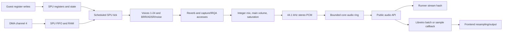

# Phase 5: The sound matches the console - Research

**Researched:** 2026-11-13  
**Domain:** Deterministic fixed-point PlayStation SPU and PCM delivery  
**Confidence:** MEDIUM

<user_constraints>
## User Constraints (from CONTEXT.md)

### Locked Decisions

<!-- DATA_K8Q3M5RX_START -->
- **D-01:** Carry forward DEC.36: one integer SPU tick per 768 CPU cycles; process voices 1–24 and reverb in the documented order, checking IRQA at each modeled SPU RAM access. Keep the sample-granular model. Do not introduce an eight-cycle RAM-slot scheduler unless a pinned test or hardware trace shows sample-granular timing is insufficient.
- **D-02:** Reconcile the frozen noise description with the newer primary psx-spx update before implementation. Use its clock-slot schedule and noise capture behavior, including that clearing SPU enable does not reset the LFSR. The project research/plan must cite the exact public commit and update any stale local summary; do not preserve two conflicting algorithms.
- **D-03:** Keep the documented integer BRR, Gaussian, ADSR, mixing, and reverb design as the baseline. High ADSR-rate and phase-negative sweep behavior remains uncertain without a direct hardware oracle. Do not add an unverified model/profile switch. Reconcile reverb against the new SCPH-1001 measurements: 16-bit intermediate saturation affects output, left/right processing alternates, and the combined 39-tap input/output delay is 38 samples. The exact per-stage rounding positions remain unknown, so tests must not claim unsupported bit-exactness.
- **D-04:** Keep all SPU state instance-owned, fixed-width, bounded, and serializable. Use explicit little-endian guest-memory helpers and integer fixed-point arithmetic so `be32` and `wasm32` produce the same PCM. Continue processing silent voices and timing-sensitive capture/IRQ work when output is muted; `core.no_busy_loop` must still bound idle work.

### PCM delivery and host timing
- **D-05:** Preserve DEC.37/38: emit signed 16-bit stereo at 44,100 Hz, one sample pair for every 768 CPU cycles, with the fractional frame remainder carried forward. Never pad frames or resample inside the core. Hash the final stream after main volume and saturation and before host resampling.
- **D-06:** Use the existing public `schway_get_audio` contract and bounded audio ring. Keep libretro batch delivery for frame-sized output and retain the single-sample callback fallback. `libretro.host` must compare the actual PCM from both paths against the runner's PCM, including samples produced by the SPU rather than only the current silent stream.
- **D-07:** Keep the current emulated AV rates in Phase 5 so the reported frame cadence and the carried PCM count remain coupled. Do not change only libretro's rate metadata to the interlaced field rate. If later primary evidence warrants a different interlaced report, change and validate the field cadence, audio accumulator, AV info, and host tests together.

### Conformance and evidence
- **D-08:** Keep SOUND-01/02's required gates and fixture behavior. Use the pinned `spu/memory-transfer` hardware log for its seven transfer pass lines; use the `spu_tone` fixture, cross-lane hashes, CPU-free block-table test, host equality test, and RetroArch smoke for their stated purposes.
- **D-09:** Treat the evidence types distinctly: cross-lane PCM hashes prove determinism, runner/libretro equality proves delivery, and the transfer log proves only its named hardware cases. No pinned hardware PCM waveform was found in the current ps1-tests SPU corpus. Self-authored tone and reverb digests are regression checks, not hardware captures. Add tests for the new primary noise and measured reverb constraints without inventing a complete silicon waveform oracle or asserting unknown rounding details.
- **D-10:** Add no new dependency for SPU math, sampling, or testing. Prefer small local C helpers and pinned, noticed reference data. Keep every behavior check in the CI inventory; avoid repository gates that prevent no named fault.

### the agent's Discretion
- Choose private struct fields, helper boundaries, test partitioning, and plan waves while preserving the public API, source provenance, fixed-width state, and exact requirements above.
- Keep comments and hardware docs tied to sources. Record measured, documented, derived, and still-unknown behavior separately.

### Deferred Ideas (OUT OF SCOPE)
- CD-ROM input, XA decoding, CD-DA decoding, and disc-driven audio remain Phase 6. Keep the Phase 5 hash/output boundary compatible with those later mixer inputs.
- Exact high-rate ADSR quirks and the remaining reverb rounding gap stay evidence questions. Do not invent a profile toggle or a hardware capture requirement for the owner.
- The audio-rate question for interlaced fields remains open at the project level; Phase 5 keeps the existing emulated rate unless a complete cadence-and-audio change is supported by new evidence.
<!-- DATA_K8Q3M5RX_END -->
</user_constraints>

<phase_requirements>
## Phase Requirements

| ID | Description | Research Support |
|----|-------------|------------------|
<!-- DATA_V4F7X9PL_START -->
| SOUND-01 | `ctest -L audio` steps the SPU model (one tick per 768 cycles, voices 1 to 24 then reverb, BRR decode with carried history, the 512-entry gaussian table, the ADSR step rule checked against the ares-generated table, the psx-spx noise form, the two-phase reverb with the 39-tap FIR, capture buffers written every sample, int32 mixing saturated at the documented points, IRQ on any RAM access at IRQA, the 32-halfword FIFO and DMA4 transfer paths) and the nightly lane compares the ps1-tests `spu/memory-transfer` log's seven hardware pass lines; `schwaystation-run --hash-audio` prints the SHA-256 over the int16 stereo stream for the `spu_tone` fixture (`audio@600`, `mailbox@600` with per-voice ENVX records), identical on every lane, where a unit test derives the same PCM from the block table without the CPU; exactly `frame_cycles / 768` samples per frame (737 or 738 NTSC, 886 or 887 PAL), never padded; `fuzz.regress.spu` replays its seeds. | Hardware log, SPU model, frame cadence, deterministic hash and CPU-free table-test boundaries are detailed below. |
| SOUND-02 | The libretro batch and single-sample audio paths deliver PCM equal to the runner's stream, shown by the in-process `libretro.host` test; the hosted RetroArch session boots `spu_tone.exe` as content under the stub kernel (the GAME-07 path) and proves video only; `core.no_busy_loop` holds for the idle SPU. | Existing API ring and libretro callback seams, stream-equality test pattern, and hosted smoke boundary are detailed below. |
<!-- DATA_V4F7X9PL_END -->
</phase_requirements>

## Project Constraints (from AGENTS.md)

- Reuse only permissively licensed code or data with recorded provenance; never open the prohibited emulator sources. Keep external dependencies out of this phase. [AGENTS.md rules 1, 12]
- Ship only the C library, headless runner and libretro core; no window or device implementation. [AGENTS.md rule 2]
- Keep the tree free of unlisted binary assets and personal data; commits use the noreply identity and hygiene hooks. [AGENTS.md rule 3]
- Core code is integer-only, instance-owned, deterministic and bounded; hosts supply BIOS and sectors. [AGENTS.md rule 4]
- Each behavior change has a gating test in the CI workflow. Public header stays terse; maintainer/testing docs live under `docs/`. [AGENTS.md rule 5]
- Automate deterministic, recurring integration and smoke checks; record one-off command/exit evidence. Owner checks are reserved for identity-bound consent or their own hardware. [AGENTS.md rule 6]
- Repository gates use CMake `-P` or POSIX shell, have an absolute phase line budget and prevent a named fault; RetroArch end-to-end test code stays below 300 lines. [AGENTS.md rule 7]
- Do not add process ceremony, attempts or self-metering. [AGENTS.md rule 8]
- Follow GSD steps and autonomous guidance; record runtime/model in `STATE.md` at each phase step. Stop after verify and before ship. [AGENTS.md rule 9]
- Never commit on `main` once a remote exists; ship via PR/auto-merge and confirm the hosted CI/release results at the ship boundary. [AGENTS.md rule 10]
- Evidence is command, exit status and run URL, never a committed log. [AGENTS.md rule 11]
- Public pins must resolve on GitHub; fetch sibling source through `gh api`, not a local checkout. [AGENTS.md rule 12]
- Treat sibling lessons as hypotheses until reproduced locally. [AGENTS.md rule 13]
- Plan 1 owns the CMake skeleton and each per-directory test inventory; later plans can parallelize only when they share no header or inventory. Split plans over 30 minutes. [AGENTS.md rule 14]

## Summary

Implement the SPU inside the existing C core and route its samples through the existing audio API. Preserve one sample-granular tick per 768 CPU cycles, native 44.1 kHz signed stereo PCM, carry-forward frame remainder, and the existing AV-rate contract. The core implementation surface spans scheduler, bus, DMA4, instance state and state serialization; the host-facing surface spans the runner audio hash and libretro batch/single delivery. [VERIFIED: `05-CONTEXT.md` D-01, D-04–D-07; `src/frame.c:39-52,126-128`; `src/sched.c:28-62`; `src/state.c:85-117`]

The primary source updates are resolved and the stale local noise summary is updated in `.planning/preparation/PSX-SPU-CDROM-AND-MDEC.md`. The evidence must stay separated: transfer log lines are hardware transfer cases; reverb figures are measured constraints; self-authored fixture digests and cross-lane hashes are regressions and determinism checks; runner/libretro byte equality proves stream delivery. None of these claims a full reference PCM waveform. [CITED: psx-spx noise update, `docs/ps1/spu/soundprocessingunitspu.md` §§SPU Noise Generator and ATTR; SCPH-1001 reverb update, `docs/soundprocessingunitspu.md` §Reverb Precision; ps1-tests `spu/memory-transfer/psx.log`]

**Primary recommendation:** plan an interface-first skeleton and exact test inventories, then implement and validate the SPU as a bounded scheduled module. Introduce the pinned transfer program/log at the first runnable DMA path, use focused behavior tests for the newly measured noise/reverb constraints, and finish with fixture hashes and host stream equality. [VERIFIED: `.planning/phases/03-the-gte-matches-the-hardware-cases-dma-and-timers/03-01-PLAN.md:45,105-110`; `.planning/phases/04-games-play-in-retroarch/04-01-PLAN.md:31,72-73,101`]

## Architectural Responsibility Map

| Capability | Primary Tier | Secondary Tier | Rationale |
|---|---|---|---|
| SPU clocks, voices, BRR, envelopes, noise, reverb, capture, IRQ and RAM | API / Backend | Database / Storage (SPU RAM) | The core owns deterministic chip state and work at scheduled emulated deadlines. [VERIFIED: `05-CONTEXT.md` D-01, D-04; `src/sched.c:28-62`] |
| PCM ring and public drain | API / Backend | — | Existing `schway_get_audio` drains stereo pairs from the core-owned bounded ring. [VERIFIED: `include/schwaystation.h:227-234,276`; `src/internal.h:45-52,136-139`] |
| Runner audio hash | API / Backend | — | Runner must hash the canonical PCM stream at the locked post-main-volume/pre-host-resample boundary. [VERIFIED: `05-CONTEXT.md` D-05; `.planning/REQUIREMENTS.md:76`] |
| Libretro audio callbacks | Browser / Client (host adapter) | API / Backend | Adapter drains core PCM and sends frame-sized batches when available, with sample callback fallback. [VERIFIED: `libretro/libretro.c:879-899`] |

## Standard Stack

### Core

| Library / tool | Version | Purpose | Why standard |
|---|---|---|---|
| Project C core | C17 | Fixed-point SPU module and shared API | The existing project compiler contract is C17 with extensions disabled. [VERIFIED: `CMakeLists.txt:16-18`] |
| Existing CMake/CTest workflow | Repository preset | Build and run the inventory of gating behavior checks | Reuse the CI workflow and exact inventory mechanism; do not introduce another framework. [VERIFIED: `AGENTS.md` rule 5; `.planning/preparation/ENGINEERING.md:109-117`] |
| Existing libretro API header | Vendored project copy | Audio batch callback and single-sample fallback | No new adapter API or package is needed. [VERIFIED: `libretro/libretro.c:879-899`] |

The current timing/ring constants are source-owned: <!-- DATA_B6C2Q9WT_START -->`#define SCHWAY__CYCLES_PER_PAIR 768u`, `#define SCHWAY__NTSC_MAX_PAIRS 738u`, `#define SCHWAY__PAL_MAX_PAIRS 887u`, and `#define SCHWAY__AUDIO_RING_PAIRS (4u * SCHWAY__PAL_MAX_PAIRS)`.<!-- DATA_B6C2Q9WT_END --> [VERIFIED: `src/internal.h:45-52`]

**Installation:** None. **Package legitimacy audit:** not applicable; D-10 prohibits adding packages for SPU math, sampling or testing. [VERIFIED: `05-CONTEXT.md` D-10]

## Architecture Patterns

### System Architecture Diagram



The phase boundary is the post-main-volume, saturated PCM before host resampling; later CD audio/XA sources may join before this boundary in Phase 6. The diagram shows conceptual ownership, not a per-cycle memory-slot scheduler. [VERIFIED: `05-CONTEXT.md` D-01, D-05, Deferred Ideas; `.planning/preparation/ARCHITECTURE.md:246-252`]

### Recommended Project Structure

`src/spu.[ch]` and `tests/spu/{tests.cmake,inventory.txt}` are the likely single-chip module and exact test-registration seam. This is a planning recommendation based on the one-module-per-chip and inventory conventions; the paths are not yet created. [ASSUMED]

### Pattern 1: Scheduled sample tick

Have the scheduler expose the next SPU deadline and run one tick at each 768-cycle boundary. Keep voice order, reverb order and IRQA checks at each modeled SPU RAM access; retain sample granularity unless a named pinned test or hardware trace demonstrates the need for finer timing. Do not let a due device run repeatedly in one scheduler dispatch. [VERIFIED: `05-CONTEXT.md` D-01; `src/sched.c:25-62`]

### Pattern 2: State versus host drain queue

Serialize all machine SPU registers, RAM, voice history, envelope, noise and reverb state with the existing field visitor and explicit little-endian helpers. Keep the host drain ring outside save state; the existing state visitor enumerates machine devices, while the queue is an API delivery buffer. [VERIFIED: `05-CONTEXT.md` D-04, D-06; `src/state.c:85-117`; `src/internal.h:136-139`]

### Pattern 3: Host audio delivery

Preserve the existing adapter shape:

<!-- DATA_M2Q7W8CN_START -->
```c
if (audio_batch_cb != NULL) {
    (void)audio_batch_cb(samples, io.written);
} else if (audio_cb != NULL) {
    for (i = 0; i < io.written; i++) {
        audio_cb(samples[2u * i], samples[2u * i + 1u]);
    }
}
```
<!-- DATA_M2Q7W8CN_END -->

This is existing adapter code; `libretro.host` should compare both callback paths byte-for-byte with the runner stream once the runner emits SPU PCM. [VERIFIED: `libretro/libretro.c:893-898`; `tests/libretro/host.c:735-758,777-785`]

### Anti-Patterns to Avoid

- Replacing the sample tick with 8-cycle slots without direct evidence. [VERIFIED: `05-CONTEXT.md` D-01]
- Treating a deterministic hash, a stream-equality test, or a transfer log as a hardware waveform oracle. [VERIFIED: `05-CONTEXT.md` D-08, D-09]
- Resetting noise state when SPU enable clears or capturing only a one-bit noise signal. [CITED: [psx-spx noise update](https://github.com/psx-spx/psx-spx.github.io/commit/3717718f642ce2ca9ff590b65918fb3a46279cc4), `docs/ps1/spu/soundprocessingunitspu.md:656-684`]
- Asserting exact reverb rounding positions or a full bit-exact Room preset waveform. [CITED: [psx-spx SCPH-1001 reverb update](https://github.com/psx-spx/psx-spx.github.io/commit/a37f2fec163e149f4e3e39599eb43c65c21181a8), `docs/soundprocessingunitspu.md:911-943`]
- Padding frame audio, resampling inside the core, skipping muted voices/capture/IRQA work, or treating host callback counts as silicon behavior. [VERIFIED: `05-CONTEXT.md` D-04–D-07]

## Don't Hand-Roll

| Problem | Don't Build | Use Instead | Why |
|---|---|---|---|
| Public PCM queue and drain | A second audio API or adapter-specific buffer | Existing `schway_get_audio` and bounded instance ring | Keeps library, runner and libretro on one stream boundary. [VERIFIED: `include/schwaystation.h:227-234,276`; `src/internal.h:136-139`] |
| Hash implementation | A new digest library | Existing runner SHA-256 path | Phase requirement asks for stream hashing; no dependency is authorized. [VERIFIED: `05-CONTEXT.md` D-10; `runner/sha256.c`] |
| DSP sampling and fixed-point helpers | A general-purpose audio dependency | Small local integer helpers and pinned/attributed integer tables | Keeps the dependency tree flat and behavior reproducible. [VERIFIED: `AGENTS.md` rules 1, 4; `05-CONTEXT.md` D-10] |

## Common Pitfalls

### Evidence categories get conflated

**What goes wrong:** Tests accidentally claim hardware accuracy from repeatability or host agreement. **How to avoid:** Keep separate checks and report labels: hardware transfer log, measured reverb constraints, deterministic regression digests, and stream-delivery equality. The pinned transfer log covers its seven named transfer pass lines only. [CITED: [pinned ps1-tests SPU log](https://github.com/JaCzekanski/ps1-tests/blob/f727802fead11f1daa7549285548392ef87749cb/spu/memory-transfer/psx.log)]

### Stale noise-clock algorithm

**What goes wrong:** The older decrementing timer and the newer slot schedule coexist or are selected by an invented mode. **How to avoid:** Follow the pinned `3717718f642ce2ca9ff590b65918fb3a46279cc4` slot table, no-reset behavior and full noise capture behavior as the single documented model. The local preparation summary has been updated to remove the old alternative. [CITED: [noise update](https://github.com/psx-spx/psx-spx.github.io/commit/3717718f642ce2ca9ff590b65918fb3a46279cc4)]

### Reverb precision is overstated

**What goes wrong:** A plan demands exact internal product rounding or treats a self-authored preset digest as silicon data. **How to avoid:** Assert intermediate 16-bit saturation, alternating left/right processing and the 38-sample combined delay; retain exact arithmetic rounding as unresolved. The SCPH-1001 Room capture reports residual mean deviation around 24 LSB on a wet-dominated channel even after matching known constraints. [CITED: [reverb update](https://github.com/psx-spx/psx-spx.github.io/commit/a37f2fec163e149f4e3e39599eb43c65c21181a8), `docs/soundprocessingunitspu.md:911-943`]

### Muting skips machine work

**What goes wrong:** Silent or muted voices stop advancing and capture/IRQ results drift. **How to avoid:** Continue the scheduled model and timing-sensitive RAM checks regardless of audible output; keep the idle-work bound in `core.no_busy_loop`. [VERIFIED: `05-CONTEXT.md` D-04]

### Padding hides cadence errors

**What goes wrong:** A fixed sample count per video frame masks fractional frame remainder errors. **How to avoid:** Keep the accumulator; assert the exact per-frame counts and never pad. Do not change AV metadata without updating field cadence and audio accumulation together. [VERIFIED: `05-CONTEXT.md` D-05, D-07; `.planning/REQUIREMENTS.md:76`]

## Code Examples

The existing libretro adapter uses the batch callback when registered and sends stereo pairs one at a time otherwise. See Pattern 3 and its exact source excerpt above. The official libretro core guide recommends batch delivery rather than invoking the per-sample callback for every frame. [CITED: [Libretro core development guide](https://docs.libretro.com/development/cores/developing-cores/)]

## State of the Art

| Prior local description | Current source-backed description | Evidence |
|---|---|---|
| Noise advances by a decrementing timer and may clock repeatedly in a sample. | A pinned psx-spx update describes a four-quarter slot schedule, one-or-fewer LFSR clocks per output sample, no reset on ATTR disable, and full noise-level capture for voices 1/3. | [CITED: [commit 3717718f](https://github.com/psx-spx/psx-spx.github.io/commit/3717718f642ce2ca9ff590b65918fb3a46279cc4), `docs/ps1/spu/soundprocessingunitspu.md:656-684`] |
| Reverb formula could be interpreted as bit-exact per-stage rounding. | SCPH-1001 measurements constrain internal 16-bit saturation, left/right alternation and 38-sample in/out delay, while exact per-stage rounding remains unknown. | [CITED: [commit a37f2fec](https://github.com/psx-spx/psx-spx.github.io/commit/a37f2fec163e149f4e3e39599eb43c65c21181a8), `docs/soundprocessingunitspu.md:911-943`] |

## Assumptions Log

| # | Claim | Section | Risk if Wrong |
|---|---|---|---|
| A1 | `src/spu.c` / `src/spu.h` and `tests/spu/` are the cleanest new ownership seams. | Recommended Project Structure | Planner may need to adjust paths to the current CMake organization; no public contract depends on this suggestion. |

## Open Questions

1. Exact per-stage reverb rounding and saturation positions remain unidentified. Use the measured constraints for bounded regressions and avoid a full-waveform pass criterion. [CITED: [SCPH-1001 reverb update](https://github.com/psx-spx/psx-spx.github.io/commit/a37f2fec163e149f4e3e39599eb43c65c21181a8), `docs/soundprocessingunitspu.md:911-943`]
2. High ADSR-rate behavior and phase-negative sweep behavior remain uncertain without a direct hardware oracle. Implement the documented integer baseline, with no unverified profile toggle. [VERIFIED: `05-CONTEXT.md` D-03, Deferred Ideas]
3. Interlaced audio rate remains a project-level question. Keep the current Phase 5 emulated rate; any later change must update field cadence, the accumulator, AV info and host tests together. [VERIFIED: `05-CONTEXT.md` D-07, Deferred Ideas]

## Environment Availability

| Dependency | Required by | Available | Version | Fallback |
|---|---|---:|---|---|
| CMake | local build/workflow | Yes | 4.4.3 | — |
| Ninja | build backend | Yes | 1.13.2 | — |
| Clang | local C compiler | Yes | Apple clang 21.0.0 | CI compiler matrix |
| GitHub CLI | pinned-source verification / hosted workflow inspection | Yes | 2.101.0 | GitHub API |
| RetroArch | hosted smoke / local UI session | No | — | hosted RetroArch job supplies the phase smoke; no local app activation needed for research |

Availability is from local `command -v` and `--version` probes on 2026-11-13; no tests or apps were run.

## Sources

### Primary

- [psx-spx noise-clock update, commit `3717718f642ce2ca9ff590b65918fb3a46279cc4`](https://github.com/psx-spx/psx-spx.github.io/commit/3717718f642ce2ca9ff590b65918fb3a46279cc4) — exact path `docs/ps1/spu/soundprocessingunitspu.md`, §§SPU Noise Generator and ATTR; source lines 656–684. Commit and patch were fetched with GitHub API.
- [psx-spx SCPH-1001 reverb measurement, commit `a37f2fec163e149f4e3e39599eb43c65c21181a8`](https://github.com/psx-spx/psx-spx.github.io/commit/a37f2fec163e149f4e3e39599eb43c65c21181a8) — exact path `docs/soundprocessingunitspu.md`, §Reverb Precision; source lines 907–943. Commit and patch were fetched with GitHub API.
- [JaCzekanski/ps1-tests SPU tree at `f727802fead1`](https://github.com/JaCzekanski/ps1-tests/tree/f727802fead11f1daa7549285548392ef87749cb/spu) — resolved full commit `f727802fead11f1daa7549285548392ef87749cb`; `spu/memory-transfer/psx.log` provides transfer pass lines. `spu/playback/README.md` says its dump was captured using Avocado, so it is not a silicon PCM capture.
- [Libretro core development guide](https://docs.libretro.com/development/cores/developing-cores/) — recommends batch audio callback for frame-sized output.

### Project Sources

- `AGENTS.md`, `.planning/AUTONOMOUS.md`, `.planning/LESSONS.md`, `.planning/preparation/README.md`, `.planning/preparation/DECISIONS.md`, `.planning/preparation/PSX-SPU-CDROM-AND-MDEC.md`, `.planning/preparation/ARCHITECTURE.md`, `.planning/preparation/CONFORMANCE.md`, `.planning/preparation/HOSTS-AND-INTEGRATION.md`, `.planning/preparation/ENGINEERING.md` — project constraints, current architecture, evidence model and workflow patterns.
- `.planning/phases/05-the-sound-matches-the-console/05-CONTEXT.md`, `.planning/REQUIREMENTS.md`, `.planning/config.json` — locked phase decisions, requirements and workflow gates.
- `src/frame.c`, `src/internal.h`, `src/sched.c`, `src/bus.c`, `src/dma.c`, `src/state.c`, `include/schwaystation.h`, `runner/main.c`, `runner/sha256.c`, `libretro/libretro.c`, `tests/libretro/host.c` — existing integration seams.

## Metadata

**Confidence breakdown:**
- Standard stack: HIGH — project C standard and build/test contracts are directly declared in repository files.
- Architecture: MEDIUM — upstream behavior is documented and integration seams are read in source; implementation partition remains a planning choice.
- Pitfalls and evidence limits: MEDIUM — exact noise update and measured reverb constraints are pinned; exact reverb arithmetic and some ADSR quirks remain open.

**Research date:** 2026-11-13  
**Valid until:** 2026-12-13 for stable architecture; re-check pinned hardware-source updates before implementation.
