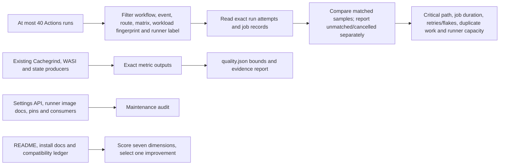

<user_constraints>
## User Constraints (from CONTEXT.md)

### Locked Decisions

### CI evidence and reliability
- **D-01:** Compare no more than the latest 40 runs, and calculate timing or speedup only for runs with matching workflow, matrix, and workload fingerprints. Show which runs match, their sample size, run URLs, critical path, job durations, queue time when available, duplicate work, retries, flakes, and runner-core use. Unmatched, cancelled, metadata-only, or otherwise different workloads may be described but must not be pooled into a speedup claim.
- **D-02:** Derive a changed timeout from twice the slowest comparable run for that job and record the source run ID beside it. If the comparable sample is absent, keep the existing timeout and report the evidence gap. Fix a reproduced flaky cause or name the stronger retained signal; do not mask a failure, drop coverage, or treat an unreliable harness assertion as a product failure.
- **D-03:** Re-evaluate the Phase 16 BE32 candidate with both long tests, libretro.host and libretro.input.movies. Keep current gates unless private same-configuration workspaces, disjoint selectors, complete test-inventory and JUnit unions, fixture/artifact/hash preservation, and a comparable hosted run prove a real critical-path reduction after duplicated setup. Runner time alone is not a billing-cost claim. TODO-052 is in scope for this measured review.
- **D-04:** Audit duplicate runner/checkpoint work through TODO-049, but remove a command only if new evidence proves the result is redundant and an independent check remains. Keep TODO-051 deferred: the recorded safe Nightly route exceeded the gate-code budget, and it may be revisited only after a measured refactor fits all controls without weakening the full scheduled/manual workload or conservative unknown-path fallback.
- **D-05:** Recheck TODO-022 against the current ten-job Windows-x64 sample and record a no-reproduction disposition if that sample remains clean. Do not change the test or weaken its signal solely because an old one-off failure was recorded.

### Quality, performance, and public claims
- **D-06:** Score all seven dimensions from TUNE-09 on a 1-5 scale with direct evidence links before choosing the improvement. Make exactly one verified improvement to the lowest-scoring dimension. If scores tie, use the observed user or maintainer impact and explain the tie-break; the improvement is selected after measurement, not in advance.
- **D-07:** Remeasure only the existing quality.json producers on their defined, matching configurations. Update each floor or ceiling only from that producer's exact result; leave a metric unchanged and name the missing evidence when a comparable producer is unavailable. Do not guess or widen a limit to make a run pass.
- **D-08:** Keep low-power device rates explicitly labeled as assumptions until measured on the named hardware. The wasm32 hash lane proves determinism under Wasmtime, not browser speed. Keep measured values separate from estimates in user and maintainer guidance.
- **D-09:** Compatibility claims remain limited to the title, configuration, and predicates actually measured. Inventory counts and protocol/profile tests are not playability evidence; libretro remains experimental until every required capability row passes. Phase 19's one retail title cannot imply broad library support.

### Repository, upgrades, and documentation
- **D-10:** Use scripts/apply-repo-settings.sh --check as the read-only repository-settings audit. Check active runner labels/images and actual tool consumers against current primary upstream release evidence. Keep unrelated pins and caches unchanged absent a specific security, compatibility, or measured-performance reason.
- **D-11:** Reconcile the older DEC.94 wording against the later Phase 7 decision and evidence: do not enable Dependabot auto-merge. Fold TODO-010 only as a conditional evaluation: add a minimal grouped GitHub Actions update configuration only if the new quality score selects upgrade path as the weakest dimension (or selects it after an evidence-based tied-lowest review). Keep TODO-011 and TODO-012 deferred because their auto-merge behavior conflicts with the later Phase 7 decision.
- **D-12:** Refresh README, install, compatibility, hardware, and maintainer guidance only where the audit shows drift. Preserve the concise user README and existing byte budgets. Update PRODUCT-ROADMAP.md and PROMPT-COVERAGE.md from measured outcomes and export only new, applicable lessons with evidence.
- **D-13:** Keep the dependency tree small. Prefer existing project tools or a small, purpose-built copy when they solve the need; add a dependency only when the phase has a concrete requirement the current tools cannot meet.

### Folded Todos
- **TODO-052 — Evaluate BE32 shards for long libretro host tests:** update the candidate using both long tests and its exact selector, fixture, JUnit, artifact, and hosted timing contract; do not split without a measured improvement.
- **TODO-049 — Review runner and checkpoint repeats:** include the current duplication evidence in the CI report; retain independent deterministic checks unless new evidence supports a safe reduction.
- **TODO-022 — Triage the Windows DLL consumer signal:** review the later Windows-x64 sample and record whether its ten-run no-reproduction condition is met; do not add an unsupported retry or hide the exit status.
- **TODO-010 — Add grouped Dependabot configuration:** evaluate only after the seven-dimension score. Implement the minimal Actions-only config only if upgrade path is selected as weakest; never enable auto-merge.

### the agent's Discretion
- Choose the exact run cohort, report layout, score evidence, tie-break rationale, and single improvement after inspecting current evidence.
- Use current official GitHub documentation and APIs for facts that can change; prefer project-owned run records, producers, and pinned references for behavior and measurements.
- Run cheap selectors, inventory, artifact, and budget checks before any long build or hosted run. Add a permanent preflight only when it prevents a recurring fault already named by a requirement.
- No owner choice is needed before planning: the project's autonomous discussion rules authorize following these evidence-backed recommendations, and no unresolved decision changes scope, authority, risk, cost, or a phase boundary.

### Deferred Ideas (OUT OF SCOPE)
- **TODO-011 and TODO-012 — Dependabot auto-merge workflow and guard:** defer because the later Phase 7 context and evidence explicitly keep update PRs reviewable and do not authorize auto-merge.
- **TODO-051 — Route Nightly pull-request jobs by changed work:** defer until a measured refactor fits the complete required controls inside the existing gate budget; preserve full scheduled/manual runs and the conservative fallback.
- No unmeasured cache, concurrency increase, broad matrix reduction, dependency, or pin refresh.
- No browser-speed or named-device performance claim without the corresponding run; no broader compatibility claim from inventory counts, fixture protocol tests, or one retail title.
- No Phase 18 or Phase 19 playability implementation in this tune-up.
</user_constraints>

# Phase 17: A measured and trustworthy playability baseline — Research

**Researched:** 2026-11-27
**Domain:** CI reliability, deterministic performance measurement, repository maintenance and evidence-scoped emulator compatibility
**Confidence:** HIGH

<phase_requirements>
## Phase Requirements

| ID | Description | Research support |
|----|-------------|-----------------|
| TUNE-07 | The tune-up compares up to the latest 40 CI runs with matching workflow, matrix and workload fingerprints, reports the critical path, duplicate work, flaky checks and core use, and makes no speedup claim when runs are not comparable. | Use bounded Actions data and the project fingerprint producer; report unmatched runs separately. [VERIFIED: .planning/REQUIREMENTS.md:31] |
| TUNE-08 | The tune-up reports the slowest matching job and run, reviews flaky checks, and derives any changed timeout from twice the slowest comparable run; it fixes the cause or names the stronger signal replacing a flaky check. | Need exact run attempts, matching jobs, source run IDs and the TODO-022 sample. [VERIFIED: .planning/REQUIREMENTS.md:32] |
| TUNE-09 | A linked 1–5 review covers performance, CI/CD, ease of use, architecture, documentation, upgrade path and compatibility breadth; it makes and verifies one evidence-backed improvement to the weakest dimension. | Score current evidence before selecting exactly one change; Phase 7 is precedent only. [VERIFIED: .planning/REQUIREMENTS.md:33] |
| TUNE-10 | The tune-up remeasures the existing quality.json producers and ratchets their bounds to measured results, rechecks low-power device assumptions, and makes no guessed budget or quality-bound change. | Existing five producer metrics and their exact configurations define remeasurement. [VERIFIED: .planning/REQUIREMENTS.md:34; .github/workflows/ci.yml:442-458,743-746,931-985,1229-1253] |
| TUNE-11 | The tune-up checks repository settings, Dependabot, runner images and existing tool pins; refreshes affected maintainer, hardware and install documentation; updates the rolling roadmap and prompt coverage; and exports lessons without changing unrelated pins or caches absent evidence. | Existing settings audit and current official GitHub docs support a scoped review. [VERIFIED: .planning/REQUIREMENTS.md:35] |

The requirement wording above is verbatim from `.planning/REQUIREMENTS.md:31-35`. [VERIFIED: .planning/REQUIREMENTS.md:31-35]

## Summary

Use current GitHub Actions run/job APIs, `scripts/ci-critical-path.sh`, existing `quality.json` producers and current user docs. Limit the sampled run set to at most 40; compare only exact workflow, event/route, matrix, workload fingerprint and runner-label matches. The current CI timing gate validates exact run/attempt/job pagination and defers comparison successfully when its digest differs. [VERIFIED: scripts/ci-critical-path.sh:7-17,30-44,183-194]

The bounded API snapshot fetched for this research returned 40 runs for the CI workflow. The newest run was a metadata route: only `changes` and `hygiene` ran; full matrix jobs including BE32, WASI, perf and RetroArch were skipped. It cannot establish a full-CI speedup. Recollect the current cohort and producer results during phase work; preserve existing bounds if matching evidence is absent. [VERIFIED: GitHub REST query, 2026-11-27; https://github.com/szTheory/schwaystation/actions/runs/46071535381]

Score all seven dimensions before choosing exactly one verified improvement. Do not preselect a timeout change, CI split, Dependabot config or docs rewrite. Phase 7’s prior scores and README correction are precedent, not a default result. [VERIFIED: .planning/phases/17-a-measured-and-trustworthy-playability-baseline/17-CONTEXT.md:16-39; .planning/milestones/v2.0-phases/07-faster-and-more-trustworthy-ci/07-QUALITY-REVIEW.md:3-25]

**Primary recommendation:** Plan measurement and audit tasks first, then choose the one evidence-backed lowest-dimension improvement. No matching cohort means report the gap and retain timeouts, gates and bounds. [VERIFIED: 17-CONTEXT.md:16-39]

## Architectural Responsibility Map

| Capability | Primary tier | Secondary tier | Rationale |
|------------|--------------|----------------|-----------|
| Workflow run/job evidence | GitHub Actions / hosted CI | Maintainer report | Official API provides run filters, attempt data, job timing and runner metadata; the report applies project fingerprints. [CITED: https://docs.github.com/en/rest/actions/workflow-runs; https://docs.github.com/en/rest/actions/workflow-jobs] |
| Performance/quality metrics | Existing CI producer jobs | CMake gate and quality registry | Existing workflows produce Cachegrind, WASI size, serialized state and critical-path values; CMake checks bounds. [VERIFIED: .github/workflows/ci.yml:442-458,743-746,931-985,1229-1253; tests/cmake/quality.cmake:7-8,74-100] |
| Repository settings, images and pins | GitHub repository configuration | Maintainer audit | Existing read-only settings mode and official runner release records support the maintenance audit. [VERIFIED: scripts/apply-repo-settings.sh:41-99; pins.txt:1-17] |
| Install and compatibility claims | README/docs and evidence ledger | Phase evidence report | Public claims should follow the exact measured title/configuration/predicates. [VERIFIED: README.md:7-10,19-35; docs/compatibility.md:13-24,33-44; tests/compat/required-capabilities.csv:1-52] |

## Standard Stack

### Core
| Component | Version | Purpose | Why standard |
|-----------|---------|---------|--------------|
| GitHub Actions REST API | Current documented API | Bounded workflow/job evidence capture | Existing project reports and producer already use it; no new service is needed. [CITED: https://docs.github.com/en/rest/actions/workflow-runs; https://docs.github.com/en/rest/actions/workflow-jobs] |
| `gh`, `curl`, `jq` | Local probe: 2.101.0, 8.7.1, 1.7.1 | Read-only API queries and structured extraction | Tools already present in the research environment. [VERIFIED: local version probe, 2026-11-27] |
| `scripts/ci-critical-path.sh` and `quality.json` | Repository-owned | Validate exact-attempt job payload, compute current DAG and compare only a matching digest | Existing authoritative producer and gate. [VERIFIED: scripts/ci-critical-path.sh:30-44,100-120,183-194; quality.json:12-21] |
| CMake quality check | Local CMake 4.4.3; project preset requires 4.3 or later | Validate exact metric bounds | Existing CMake check allows only declared metric keys and exact integer bounds. [VERIFIED: tests/cmake/quality.cmake:1-8,25-46,74-100; docs/testing.md:8-15] |

### Supporting
| Source | Use |
|--------|-----|
| GitHub runner-images README/release history | Check active runner labels and image retirement/update notices before considering changes. [CITED: https://github.com/actions/runner-images/blob/main/README.md; https://github.com/actions/runner-images/releases] |
| Dependabot update docs | Only if upgrade path wins the seven-dimension score; keep updates reviewable and auto-merge off. [CITED: https://docs.github.com/en/code-security/how-tos/secure-your-supply-chain/secure-your-dependencies/configure-version-updates; https://docs.github.com/en/code-security/reference/supply-chain-security/dependabot-on-actions] |

No new package installation is in scope. No package legitimacy audit is needed unless planning adds a concrete external dependency. [VERIFIED: 17-CONTEXT.md:29-39]

## Architecture Patterns

### System Architecture Diagram

### Recommended Project Structure
Keep evidence reports under the phase directory, following Phase 7’s separate CI timing, quality scoring, baselines and upgrade-audit artifacts. Keep durable conclusions and source/run links only; raw API payloads and logs are not committed. [VERIFIED: .planning/milestones/v2.0-phases/07-faster-and-more-trustworthy-ci/07-CI-EFFICIENCY.md:1-12; AGENTS.md:73-77]

### Pattern 1: Fingerprint before timing
**What:** Bound capture to at most 40 recent runs. Group only exact workflow, event/route, matrix, workload fingerprint and actual runner-label matches. Preserve run/attempt, head SHA, URL and job timestamps; report cancelled, metadata-only, incomplete and unmatched records separately. [VERIFIED: 17-CONTEXT.md:16-21; .planning/milestones/v2.0-phases/07-faster-and-more-trustworthy-ci/07-CI-EFFICIENCY.md:5-12,57-69]

**When to use:** Every timing, timeout or speedup conclusion.

The current project producer accepts only full, uncalled pull-request CI, verifies exact run ID/attempt, SHA, branch and complete job pagination, and fingerprints workflow/build/test inputs plus actual runner labels. A mismatch returns success with comparison deferred. [VERIFIED: scripts/ci-critical-path.sh:7-17,30-44,122-145,183-194]

The official API provides workflow filters and per-attempt job timestamps, labels and runner identity. It does not expose host CPU utilization. Report documented runner capacity by label if relevant; do not infer utilization or billing from wall time. [CITED: https://docs.github.com/en/rest/actions/workflow-runs; https://docs.github.com/en/rest/actions/workflow-jobs; https://docs.github.com/en/actions/reference/runners/github-hosted-runners]

**Example:**
    gh api --paginate --slurp "repos/OWNER/REPO/actions/runs/RUN_ID/attempts/ATTEMPT/jobs?per_page=100"

Use the attempt-specific endpoint and validate complete pagination. Queue time is reportable only where the necessary timestamps exist. [CITED: https://docs.github.com/en/rest/actions/workflow-jobs]

### Pattern 2: Remeasure through existing producers
**What:** Remeasure only each existing metric on its matching configuration. Change a bound only to that producer’s exact output; otherwise retain it and state the gap. [VERIFIED: 17-CONTEXT.md:23-27; tests/cmake/quality.cmake:74-100]

Current registry values are:
> `"testcard": {"floor": 1620381, "ceiling": 1620381},`
> `"gpu_motion": {"floor": 138406446, "ceiling": 138406446}`
> `"wasm": {"floor": 1014617, "ceiling": 1014665}`
> `"bytes": {"floor": 3757754, "ceiling": 3757754}`
> `"critical_path_s": { "floor": 2249, "ceiling": 3293, "workload_sha256": "316f86729c5129fc618ae0acf71014a5b18784d9e7a4f6c03ff067d0b4326ed8" }`
[VERIFIED: quality.json:3-16]

Cachegrind compares PR head to merge base; WASI measures the linked Release module; the state producer reads stable serialized bytes; the timing script computes the exact-attempt DAG. Hosted output remains authoritative unless a matching local toolchain/configuration is reproduced. [VERIFIED: .github/workflows/ci.yml:442-458,743-746,931-985,1229-1253; quality.json:35-44]

Do not treat Wasmtime hash equality as browser speed or Cachegrind Ir/frame as user frame rate. Keep low-power device rates marked as assumptions until measured on named hardware. [VERIFIED: 17-CONTEXT.md:23-27; .planning/PRODUCT-ROADMAP.md:24-37]

### Pattern 3: Score, then select one change
Score all seven dimensions with linked evidence before selecting one change. Use observed user/maintainer impact to break a tie. [VERIFIED: 17-CONTEXT.md:23-39; .planning/milestones/v2.0-phases/07-faster-and-more-trustworthy-ci/07-QUALITY-REVIEW.md:3-25]

Phase 7 scored documentation and upgrade path at 2 and selected its then-false README claim; that is precedent only. Rescore the current docs and current maintenance evidence. [VERIFIED: .planning/milestones/v2.0-phases/07-faster-and-more-trustworthy-ci/07-QUALITY-REVIEW.md:13-25]

### Pattern 4: Keep compatibility predicate-scoped
Describe only the title, configuration and predicates actually measured. Inventory counts and profile/protocol checks are not playability. [VERIFIED: docs/compatibility.md:5-24,33-44; 17-CONTEXT.md:23-27]

Phase 16 states:
> “Current build output has 16 passes and 35 unknowns, including all provider/profile boot-to-play rows; generated schwaystation_libretro.info therefore correctly remains is_experimental = "true".”
[VERIFIED: .planning/milestones/v2.0-phases/16-patches-cheats-and-compatibility-evidence/16-VERIFICATION.md:148]

The checked-in compatibility page states:
> “Libretro stays experimental while any required result is missing or fails.”
[VERIFIED: docs/compatibility.md:13-15]

Do not convert fixture/profile/provider inventory into a retail-playability or broad-library claim. Phases 18 and 19 remain outside this phase. [VERIFIED: .planning/ROADMAP.md:23-39,42-61]

### Anti-Patterns to Avoid
- **Pool unlike runs:** Push, PR, Release, Nightly, metadata-only and cancelled runs cannot establish a pooled speedup. [VERIFIED: 17-CONTEXT.md:16-21; 07-CI-EFFICIENCY.md:57-69]
- **Call wall time CPU use or cost:** API timing and runner labels identify durations and configured capacity, not CPU utilization or billing. [VERIFIED: 07-CI-EFFICIENCY.md:188-190; CITED: https://docs.github.com/en/rest/actions/workflow-jobs]
- **Widen quality bounds to make green:** Use exact outputs from matching producers. [VERIFIED: quality.json:3-16; tests/cmake/quality.cmake:74-100]
- **Make multiple lowest-dimension changes:** Exactly one verified improvement follows the score and tie-break. [VERIFIED: 17-CONTEXT.md:23-39]

## Don’t Hand-Roll

| Problem | Don’t build | Use instead | Why |
|---------|-------------|--------------|-----|
| Exact-attempt critical path | Another DAG timer or cache | `scripts/ci-critical-path.sh` and its API pagination | It validates run/attempt identity and the declared workflow graph, and defers on digest mismatch. [VERIFIED: scripts/ci-critical-path.sh:30-44,100-120,183-194] |
| Quality thresholds | New benchmark framework or guessed bounds | Current `quality.json` producers and `tests/cmake/quality.cmake` | Inputs/configurations and bound semantics are already defined. [VERIFIED: quality.json:1-18; tests/cmake/quality.cmake:7-8,25-46,74-100] |
| CI run analysis | New package/service | GitHub REST API with existing `gh`, `curl`, `jq` | Official endpoints expose run and job fields needed for a traceable report. [CITED: https://docs.github.com/en/rest/actions/workflow-runs; https://docs.github.com/en/rest/actions/workflow-jobs] |
| Compatibility evidence | Broad claim from DAT totals | Existing title ledger and required-capability matrix | Missing required evidence keeps libretro experimental. [VERIFIED: tests/compat/required-capabilities.csv:1-52; docs/compatibility.md:13-24] |

**Key insight:** A number without its matching workload/configuration, producer output and traceable source does not satisfy a measurement requirement. [VERIFIED: scripts/ci-critical-path.sh:183-194; 17-CONTEXT.md:16-27]

## Project Constraints (from AGENTS.md)
- Keep only the library, headless runner and libretro core; no window/audio/input-device code. Do not change emulator behavior absent a separately scoped evidence-backed need. [VERIFIED: AGENTS.md:26-37; 17-CONTEXT.md:7-10]
- No commercial assets, captures, traces, TTY bytes, personal paths or identifiers in repo/CI/release; do not commit raw logs. Evidence is command, exit status and run URL. [VERIFIED: AGENTS.md:28-31,73-77; .planning/REQUIREMENTS.md:14-18]
- Behavior changes require a `cmake --workflow --preset ci` gate; permanent checks name a recurring fault. [VERIFIED: AGENTS.md:37-54; .planning/REQUIREMENTS.md:20-25]
- Repository-check code is CMake `-P` or POSIX shell, with absolute 4,694-line phase ceiling; real-host RetroArch code stays within 300 lines. [VERIFIED: AGENTS.md:47-54; .planning/REQUIREMENTS.md:20-25]
- Plan 1 registers CMake skeleton and per-directory inventories; split plans exceeding 30 minutes and parallelize only when inventories/headers are disjoint. [VERIFIED: AGENTS.md:80-84]
- No Dependabot auto-merge, speculative cache/concurrency/matrix/pin/dependency change, or Phase 18/19 implementation. [VERIFIED: AGENTS.md:55-60; 17-CONTEXT.md:29-39,125-135]
- No owner verification by default; read AUTONOMOUS.md and record runtime/model in STATE at each phase step. [VERIFIED: AGENTS.md:40-66; .planning/AUTONOMOUS.md:34-56]
- Preflight inputs/counts/selectors/artifacts/budgets before long runs; inspect hosted runs and clean task-owned resources. [VERIFIED: AGENTS.md:92-128; docs/maintaining.md:56-89]

## Environment Availability

Probed without builds or tests:

| Dependency | Required by | Available | Version | Fallback |
|------------|-------------|-----------|---------|----------|
| GitHub API | Run/job evidence | ✓ | Current REST API | Public API read via curl/gh |
| gh | API and settings audit | ✓ | 2.101.0 | curl for public runs; settings still require authorized access |
| curl / jq | API queries | ✓ | 8.7.1 / 1.7.1 | gh api |
| CMake | Existing quality/policy checks | ✓ | 4.4.3 | Hosted producers |
| valgrind | Local Cachegrind reproduction | ✗ | — | Hosted perf job |
| clang-21 / wasm-ld-21 | Exact local WASI reproduction | ✗ | — | Hosted wasm32 producer |
| Wasmtime | Local WASI runner | ✓ | 50.0.1; repository pin 48.0.7 | Use hosted producer or exact pin when a local reproduction is authorized. [VERIFIED: pins.txt:10-13] |

These are availability probes only. This research ran no builds, tests, Act job or quality producer. [VERIFIED: local tool probe, 2026-11-27]

## Current Evidence Snapshot

| Evidence | Observation | Command/status |
|----------|-------------|----------------|
| Recent CI run list | Workflow ID `390754881`; 40 rows returned. Newest run was push/main `46071535381`, successful. | `curl -fsS -H 'Accept: application/vnd.github+json' -H 'X-GitHub-Api-Version: 2022-11-28' 'https://api.github.com/repos/szTheory/schwaystation/actions/workflows/390754881/runs?per_page=40' | jq ...` — exit 0. |
| Newest run jobs | 16 job records; `changes` and `hygiene` executed successfully; full matrix including BE32, WASI, perf and RetroArch was skipped. Not timing evidence for a full run. | `curl -fsS -H 'Accept: application/vnd.github+json' -H 'X-GitHub-Api-Version: 2022-11-28' 'https://api.github.com/repos/szTheory/schwaystation/actions/runs/46071535381/jobs?per_page=100' | jq ...` — exit 0; [run 46071535381](https://github.com/szTheory/schwaystation/actions/runs/46071535381). |
| Phase 16 full CI | Final hosted run passed BE32 694/694, platform jobs, RetroArch, release rehearsal and dependent hash comparison; this is correctness evidence, not a shard before/after experiment. | [run 45902643250](https://github.com/szTheory/schwaystation/actions/runs/45902643250). [VERIFIED: .planning/milestones/v2.0-phases/16-patches-cheats-and-compatibility-evidence/16-VERIFICATION.md:199] |
| Prior BE32 candidate | Phase 15 Main says “`libretro.host` ran for 1,456.53 seconds and `libretro.input.movies` for 1,041.84 seconds after the other tests completed.” It also records all 669 tests and explains duplicated setup. | [run 45685800743](https://github.com/szTheory/schwaystation/actions/runs/45685800743). [VERIFIED: .planning/todos/pending/052-be32-movie-test-shard.md:22,47-57] |

Current matrix labels are:
> `- { runner: ubuntu-26.04, preset: ci, os: linux, arch: x64 }`
> `- { runner: ubuntu-26.04-arm, preset: ci, os: linux, arch: arm64 }`
> `- { runner: macos-15, preset: ci, os: macos, arch: arm64 }`
> `- { runner: macos-15-intel, preset: ci, os: macos, arch: x64 }`
> `- { runner: windows-2025, preset: ci-msvc, os: windows, arch: x64 }`
> `- { runner: windows-11-arm, preset: ci-msvc, os: windows, arch: arm64 }`
[VERIFIED: .github/workflows/ci.yml:382-387]

As of 2026-11-27, official runner-images documentation lists those Ubuntu 26.04, macOS 15, Windows 2025 and Windows 11 Arm labels, and states macOS 14 retired from GitHub Actions on 2026-11-02. No active project matrix label requires migration for that retirement. Hosted runner capacity depends on repository visibility; labels do not measure CPU utilization. [CITED: https://github.com/actions/runner-images/blob/main/README.md; https://github.com/actions/runner-images/releases; https://docs.github.com/en/actions/reference/runners/github-hosted-runners]

## Common Pitfalls

### 1. “Latest 40” is not 40 comparable runs
The API returns different events, branches, workflows and routes. This snapshot’s newest run is metadata-only. Group fingerprints first, show matched sample size and run links, and list exclusions separately. [VERIFIED: GitHub REST snapshot, 2026-11-27; .planning/milestones/v2.0-phases/07-faster-and-more-trustworthy-ci/07-CI-EFFICIENCY.md:5-12,57-69]

### 2. Wall duration is not queue time, CPU use or billing
The API exposes job timestamps and runner labels, not actual CPU utilization. Report only available queue fields and documented runner capacity; mark unavailable data explicitly. [VERIFIED: 07-CI-EFFICIENCY.md:188-190; CITED: https://docs.github.com/en/rest/actions/workflow-jobs; https://docs.github.com/en/actions/reference/runners/github-hosted-runners]

### 3. Timeout arithmetic needs a comparable job sample
A changed timeout is twice the slowest comparable duration for that job, with source run ID. Without a comparable sample, leave it unchanged and record the gap. [VERIFIED: 17-CONTEXT.md:16-21]

### 4. Score before change
Phase 7’s earlier README defect and scores do not choose Phase 17’s change. Make exactly one improvement after current evidence and tie-break by observed impact. [VERIFIED: 17-CONTEXT.md:23-39; 07-QUALITY-REVIEW.md:13-25]

### 5. Inventory is not playability
The compatibility report has all Redump inventory entries unknown; protocol/profile tests are not title playability. Keep experimental status and public claims scoped. [VERIFIED: docs/compatibility.md:5-24; 16-VERIFICATION.md:148]

### 6. Dependabot update config does not authorize auto-merge
If upgrade path is selected, add only the conditional Actions update config. Dependabot-triggered Actions use read-only `GITHUB_TOKEN` by default and cannot access ordinary Actions secrets. [CITED: https://docs.github.com/en/code-security/how-tos/secure-your-supply-chain/secure-your-dependencies/configure-version-updates; https://docs.github.com/en/code-security/reference/supply-chain-security/dependabot-on-actions; VERIFIED: 17-CONTEXT.md:29-39,125-135]

### 7. Windows DLL no-reproduction is a ten-job sample
Read the latest ten relevant hosted Windows-x64 job results/logs and inspect `install.consumer.dll_crt`. Record no reproduction only if all ten comparable jobs are clean; otherwise preserve the gap. Do not add retries or weaken the test. [VERIFIED: 17-CONTEXT.md:16-21; .planning/todos/pending/022-windows-dll-crt-consumer-flake.md:14-34]

### 8. A BE32 split needs full coverage and a hosted improvement
Use both long tests, private same-config workspaces, disjoint selectors, complete test/JUnit union, fixtures and hashes. Phase 15 had 669 tests; Phase 16’s final job had 694, so selectors need current-inventory proof. Keep the existing gates without a comparable hosted critical-path reduction. [VERIFIED: TODO-052:22-33,53-63; 16-VERIFICATION.md:148,199]

### 9. Preserve deferred Nightly routing
TODO-051 remains deferred until the complete controls fit the absolute budget and preserve full scheduled/manual runs and unknown-path fallback. [VERIFIED: 17-CONTEXT.md:29-39,125-135; .planning/todos/pending/051-nightly-pr-job-routing.md:40-47]

## State of the Art

| Topic | Current finding | Planning implication |
|-------|-----------------|---------------------|
| Actions run/job data | Official REST endpoints provide workflow run filters and job attempt timestamps/runner fields. [CITED: https://docs.github.com/en/rest/actions/workflow-runs; https://docs.github.com/en/rest/actions/workflow-jobs] | Use exact attempts and validate full pagination/fingerprint. |
| Runner images | Official runner-images lists the active project labels; macOS 14 retired 2026-11-02. [CITED: https://github.com/actions/runner-images/blob/main/README.md] | Keep current labels unless consumer or upstream evidence justifies change. |
| Dependabot Actions updates | Official docs cover github-actions ecosystem config and workflow restrictions. [CITED: https://docs.github.com/en/code-security/how-tos/secure-your-supply-chain/secure-your-dependencies/configure-version-updates; https://docs.github.com/en/code-security/reference/supply-chain-security/dependabot-on-actions] | Evaluate only if upgrade path is the selected weakest dimension; no auto-merge. |

**Deprecated/outdated:**
- Do not introduce `macos-14`; it is retired on hosted Actions. The workflow uses macOS 15. [CITED: https://github.com/actions/runner-images/blob/main/README.md; VERIFIED: .github/workflows/ci.yml:382-387]
- Do not reuse the Phase 7 critical-path interval as a new speedup cohort. Current registry says `"workload_sha256": "316f86729c5129fc618ae0acf71014a5b18784d9e7a4f6c03ff067d0b4326ed8"` and the script defers on mismatch. [VERIFIED: quality.json:13-21; scripts/ci-critical-path.sh:183-194]

## Assumptions Log

| # | Claim | Section | Risk if wrong |
|---|-------|---------|---------------|
| A1 | Existing project APIs/scripts suffice for the currently scoped report, so no new package is needed. | Standard Stack | A concrete unmet requirement would require new legitimacy/security review. |

This is a recommendation grounded in existing producers and D-13, not a new locked project decision. [VERIFIED: 17-CONTEXT.md:29-39; scripts/ci-critical-path.sh:30-44]

## Open Questions (RESOLVED)

1. **RESOLVED: Current full-run cohort and producer values are execution-time evidence collection.** The bounded snapshot’s newest run skipped the heavy matrix; later matching full runs and exact current producer output were not established here. Plan 02 Task 1 collects the bounded matching cohort, Plan 03 Task 1 gathers exact producer output, and Plan 09 Task 2 reconciles the timing row and hosted producer results. Evidence remains uncollected at planning time; if no comparable cohort or producer evidence is available, retain existing bounds and fingerprints, report the gap, and keep required producer work pending for phase verification. No owner decision is needed. [VERIFIED: snapshot run 46071535381; 17-CONTEXT.md:16-27]
2. **RESOLVED: Latest ten Windows-x64 DLL-consumer results are execution-time evidence collection.** These logs are not collected in this research pass. Plan 02 Task 2 inspects the latest ten eligible comparable completed jobs within the same forty-run cohort to establish whether TODO-022’s ten-job clean condition is met. If fewer than ten comparable results or the required evidence are available, keep TODO-022 pending with the sample/evidence shortfall; do not expand the cohort, assert a clean disposition, or change the test without reproduced evidence. Plan 09 Task 2 preserves that disposition in the final evidence handoff. [VERIFIED: .planning/todos/pending/022-windows-dll-crt-consumer-flake.md:21-34]

These are evidence collection items, not planning blockers. [VERIFIED: .planning/AUTONOMOUS.md:14-18]

## Research Boundaries

This is not a rename/refactor/migration phase. Nyquist validation and formal ASVS sections are omitted because config states:
> `"nyquist_validation": false,`
> `"security_enforcement": false,`
[VERIFIED: .planning/config.json:37-42,64-66]

No package is introduced. No builds, tests, Act jobs, or quality producers were run for this research.

## Sources

### Primary project sources
- `.planning/phases/17-a-measured-and-trustworthy-playability-baseline/17-CONTEXT.md`; `.planning/REQUIREMENTS.md`; `.planning/STATE.md`; `.planning/ROADMAP.md`.
- `.planning/AUTONOMOUS.md`; `.planning/LESSONS.md`; `AGENTS.md`; `.planning/seeds/SEED-007-milestone-tune-up.md`; `.planning/PRODUCT-ROADMAP.md`.
- `.planning/preparation/README.md` and its referenced `BRIEF.md`, `DECISIONS.md`, `ENGINEERING.md`, `CONFORMANCE.md`, `HOSTS-AND-INTEGRATION.md`, `PROMPT-COVERAGE.md`.
- Phase 7 `07-CONTEXT.md`, `07-QUALITY-REVIEW.md`, `07-DELIVERY-EVIDENCE.md`, `07-BASELINES.md`, `07-CI-EFFICIENCY.md`, `07-UPGRADE-AUDIT.md`; Phase 16 `16-CONTEXT.md`, `16-VERIFICATION.md`, `16-LOCAL-EVIDENCE.md`.
- `quality.json`; `scripts/ci-critical-path.sh`; `.github/workflows/ci.yml`; `tests/cmake/quality.cmake`; `scripts/apply-repo-settings.sh`; `pins.txt`; current README/docs and compatibility ledgers.
- TODO-010, TODO-011, TODO-012, TODO-022, TODO-049, TODO-051, TODO-052.

### Official sources (accessed 2026-11-27)
- [REST API endpoints for workflow runs](https://docs.github.com/en/rest/actions/workflow-runs).
- [REST API endpoints for workflow jobs](https://docs.github.com/en/rest/actions/workflow-jobs).
- [GitHub-hosted runners reference](https://docs.github.com/en/actions/reference/runners/github-hosted-runners).
- [Actions runner-images README](https://github.com/actions/runner-images/blob/main/README.md) and [release history](https://github.com/actions/runner-images/releases).
- [Configure version updates](https://docs.github.com/en/code-security/how-tos/secure-your-supply-chain/secure-your-dependencies/configure-version-updates).
- [Dependabot on Actions](https://docs.github.com/en/code-security/reference/supply-chain-security/dependabot-on-actions).

## Metadata

**Confidence breakdown:**
- Standard stack: HIGH — existing project tools and official API/docs were checked.
- Architecture: HIGH — existing project-owned producers and evidence boundaries were inspected.
- Pitfalls: HIGH — decisions and prior phase/TODO evidence provide direct constraints.

**Research date:** 2026-11-27
**Valid until:** 2026-12-27; recheck dynamic GitHub runner/API/Dependabot facts before plan finalization.
