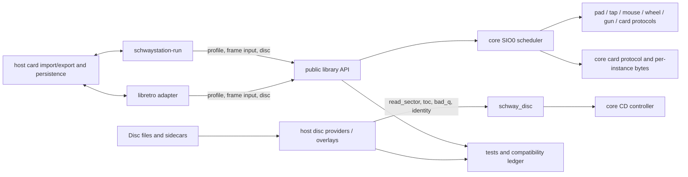

# Architecture Patterns

**Domain:** Deterministic PlayStation emulator library, command-line runner, and libretro core  
**Researched:** 2026-11-18  
**Confidence:** HIGH for shipped boundaries and libretro contracts; MEDIUM for undocumented hardware combinations; LOW-to-MEDIUM for PBP edge cases and a few protection/light-gun behaviors that need title-level evidence.

## Recommended Architecture

Extend the existing three-deliverable design. Keep the emulation library responsible for deterministic hardware behavior and keep content decoding, paths, persistence, and patch-file parsing in host-side helpers. Normalize all media providers to the already-shipped `schway_disc` descriptor, and normalize frontend controls to per-frame integer input before they enter the core.



The actual public header is the compatibility anchor: `schway_disc` already exposes raw 2352-byte sectors, 96-byte subcode, TOC, optional `bad_q`, and an identity digest. The size-tagged `schway_profile` and `schway_input` are also established extension points. Preserve their current meanings and append fields only when a v2 consumer requires them. Keep the API versioning and compatibility rules in [the public header](../../include/schwaystation.h) and [DECISIONS.md](../preparation/DECISIONS.md).

### Component Boundaries

| Component | Responsibility | Communicates With |
|-----------|---------------|-------------------|
| `src/cdrom*` | Timed CD controller behavior; requests sectors, TOC, and bad-Q status through the existing descriptor | `schway_disc`, scheduler, interrupt controller |
| `host/disc_image*` and format providers | Open content, decode/normalize sectors and subcode, build TOC, compute identity; no emulation state | Runner, libretro adapter, `schway_disc` |
| `host/sector_overlay*`, `host/sbi*` | Apply PPF/BPS sector changes and parse SBI bad-Q records before data reaches the core | Disc providers and `schway_disc` callbacks |
| `src/sio.c` | Keep byte timing, port selection, handshake/ACK, and IRQ behavior; route protocol bytes to the selected device | Device protocol modules, scheduler, IRQ |
| Small `src/` device modules | Implement each device’s protocol and per-instance state; dispatch with explicit `switch` logic | SIO0, frame-latched input, card protocol, GPU timing for guns |
| `src/card.c` | Card serial protocol, selected slot, in-memory card bytes and generation tracking | SIO0/tap, host loading and save notifications |
| `host/cards.*` | Validate/import/export raw card images and approved wrappers; atomic host writes | Runner and libretro adapter |
| Runner | CLI options, file paths, save naming, patch/cheat text parsing, selecting profiles, presenting stop reasons | Public API and host helpers |
| Libretro adapter | Translate libretro inputs, controller selections, memory callbacks, cheats and save-directory paths | Public API and host helpers |
| Compatibility ledger | Record observed title/media/profile/feature outcomes and evidence; ratchet claims from measured support | Tests, CI, release metadata |

Use one small module per device or media format and ordinary switch-based dispatch, consistent with the project’s C style and `LESSONS.md`. Avoid a generic plugin registry or global provider table: it adds indirection without improving the fixed set of core-owned devices, and makes instance ownership harder to audit. Mutable emulation state remains inside each instance; host parsers and file handles stay outside the library.

### Data Flow and Integration Rules

#### Media formats and sector overlays

All supported disc types must produce the canonical data expected by the existing callback. Add format-specific host providers behind `host/disc_image` rather than teaching `src/cdrom` about files or compression. A format adapter supplies raw sector bytes, subcode, track/index/pregap/leadout metadata, identity, and any supported bad-Q status through the existing `schway_disc` fields. Do not change that callback signature without evidence from an actual format that cannot be represented by it.

Recommended host-side units are one bounded provider per format (`disc_image_chd`, `disc_image_ecm`, `disc_image_ccd`, `disc_image_pbp`), plus shared SBI parsing and sector overlays. CHD should be an optional, default-off host dependency behind `SCHWAYSTATION_CHD`; its BSD-3-Clause license and notices are already approved in [ENGINEERING.md](../preparation/ENGINEERING.md). Keep it out of the core target. Even with libchdr’s malformed-input hardening, impose project limits on logical image size, hunk size, track count and traversals, and check every library return. The current libchdr 0.3.0 release notes document security hardening around hunk computation and metadata traversal, but do not remove the need for local resource limits ([libchdr v0.3.0](https://github.com/rtissera/libchdr/releases/tag/v0.3.0)).

Treat PBP as a distinct research risk: the available PSX format description is reverse-engineered, notes uncertain fields, and describes multi-disc/compressed-sector variants ([PSX-SPX PBP disk-image notes](https://psx-spx.consoledev.net/dev/ps1/cdr/cdromfileformats/diskimages/)). Implement only a known layout matrix backed by small fixtures; do not infer broad compatibility from one image. ECM and CCD need equivalent fixtures for supported sector modes, subcode, and TOC behavior.

Apply PPF/BPS overlays after decoding/decompression and canonical sector assembly, but before `read_sector` returns. PPF offsets address raw 2352-byte sectors; BPS patches an image stream. Keep overlay parsing, bounds checks, and file access on the host. SBI is parsed by the host helper and exposed through the existing `bad_q(lba)` callback; the core owns how that input affects CD behavior. The project’s open question about whether GetlocP returns the correct previous-good Q data for each protected title remains an acceptance test, not an assumed property. Verify it against known title sequences before claiming LibCrypt support.

Identity is a dependency of per-game saves, patches, cheats, and ledger rows. Preserve the existing serial-plus-MD5-plus-predicate ledger key where that data is available; record the media/profile used and keep unknown distinct from pass. New formats must expose stable identity through the current descriptor before the runner or libretro adapter derives per-game paths. This is a host helper concern, not core state.

#### Cards and persistence

Keep card bytes in the core instance and keep filenames and durability in host code. Reuse `host/cards.*` for raw 128 KiB card images and approved wrappers; do not make `src/card.c` parse `.gme`, `.mem`, `.psx`, `.srm`, or paths. Card serial protocol state, selected card/slot, and generation counters belong to the emulated instance. As settled in preparation, card contents and generations are host persistence, not ordinary emulation save-state payload.

For libretro compatibility, retain card 1 as `RETRO_MEMORY_SAVE_RAM` and preserve the existing `retro_get_memory_data/size` behavior. The libretro API describes SAVE_RAM as an optional memory region and recommends SAVE_DIRECTORY for more complex save data ([pinned `libretro.h`](https://github.com/libretro/libretro-common/blob/a3194c18ba65/include/libretro.h)). Keep card 2 and additional tap slots in adapter-managed files under the save directory, with writes driven by generation changes and atomic host writes. The runner uses the same card helper with its own save-directory and naming policy. Load before the first frame; flush only from the adapters. Define stable slot names from content identity plus card-slot number, including multi-disc sets, and test reload/write behavior through both frontends before advertising saves.

Multitap increases the number of card endpoints, so implement stable slot IDs in the host persistence mapping as part of the tap phase. Do not silently map multiple tap slots to the same `.srm` path. PocketStation storage can reuse card storage and its serial command path; full PocketStation ARM execution, LCD, and RTC are a separate scope and remain deferred.

#### SIO0 input and peripherals

Keep the byte scheduler and physical-port protocol in `src/sio.c`. Device modules should be deterministic state machines driven by the transmitted byte and their instance state, with input values latched at `schway_run_frame` boundaries. Extend the size-tagged `schway_input` append-only for the required v2 controls: tap child devices, relative mouse motion, wheel/neGcon/Jogcon controls, and gun pointer coordinates/offscreen/trigger state. Use fixed-width integers and documented ranges; define mouse deltas and gun positions in console-space units in the public header and prose documentation. Existing callers that provide the old, shorter input structure must retain current behavior.

Represent the multitap as a device on either physical port, with explicit child-slot selection and a child protocol state per slot. Keep the initial implementation bounded to the supported pad/card protocols and the hardware’s fixed maximum slots. Mouse, neGcon, Jogcon, and digital/analog pads can each be small protocol handlers. Avoid pushing device-specific parsing into the libretro adapter; it translates host input into the public snapshot, while protocol timing and response bytes remain core behavior.

Libretro controller subclasses describe configuration choices; polling still uses the base device IDs. For light-gun support, consume the frontend’s lightgun coordinates when available and offer pointer coordinates as an adapter fallback. RetroArch’s current input-driver guide documents that mouse uses relative tracking while pointer uses absolute coordinates and that device support varies by frontend; its macOS Cocoa table lists pointer support but no lightgun support ([RetroArch input-controller drivers](https://docs.libretro.com/guides/input-controller-drivers/)). Therefore document gun availability as host-dependent and don’t promise that every frontend exposes a lightgun device.

GunCon/Justifier support depends on beam-timed sensing, not only a new SIO packet. The current GPU tracks beam line/dot timing, but does not provide the complete pixel-brightness/threshold service required to decide whether the beam sees a bright target. Add the smallest deterministic GPU-to-gun query needed, tied to the existing integer scheduler. Convert input coordinates to a beam location in the adapter or a narrow shared transform; keep trigger sampling and hit timing inside the core. Verify both coordinates and interrupt/timing behavior using controlled fixtures before enabling light-gun claims.

#### PAL and board profiles

PAL region selection already exists in the shipped profile; v1 also has a GPU V0 flag. Do not replace or reinterpret either. Board revision is new v2 scope and may be appended to the size-tagged profile only when profile-specific behavior is ready to consume it. Use an explicit board enum and derive related defaults (CPU/GPU/SPU/CD firmware, RAM-control behavior and port capabilities) in one core profile resolver. Keep region and board as separate inputs: PAL is a video/timing region and must not imply a specific board revision. Unknown or absent appended fields should resolve to today’s default profile.

Only encode documented behavioral differences. A model label alone is not evidence for separate behavior. Add tests that vary one supported profile property at a time, include the selected board/region in hash and ledger context, and preserve the existing profile lock after the first frame. The board and region matrix in [PSX-SYSTEM.md](../preparation/PSX-SYSTEM.md) is the source map; combinations without a verified behavior stay unknown in the ledger.

#### GameShark and guest RAM writes

Separate guest-memory cheats from media patching. Parse GameShark text in a shared host helper with strict line, count, and address bounds. Convert accepted codes to a normalized list and apply them at one documented deterministic boundary (recommended: frame start) in both runner and libretro. Libretro `retro_cheat_set` should update this same list rather than keeping adapter-specific semantics.

The shipped public memory accessor returns a read-only `schway_span`; it is not a cheat-write API. Do not cast away `const` or mutate memory behind the API. If the feature’s first consumer needs direct RAM writes, add the narrowest append-only public operation that can express the supported write semantics, or a typed cheat application entry point, and test its address/width/timing rules. Keep parser and user-facing code lists out of core; keep actual writes in the core so bounds and frame ordering are deterministic.

#### Compatibility ledger and claims

The ledger is evidence, not a second runtime subsystem. Add rows only for observable cases with command, exit status, hashes, core revision, and date. Keep the existing key and pass ratchet; do not convert missing coverage into pass. Track each media format, profile, device protocol, and protection capability separately so a result for one combination does not imply the whole library works. Retire experimental metadata only after the settled threshold and capability conditions are met. Never depend on owner-supplied captures; use permitted fixtures and deterministic generated inputs.

### Patterns to Follow

#### Normalize at the host boundary

**What:** Format-specific code turns content into the existing fixed-width sector, TOC, subcode, identity, and optional bad-Q callback contract.  
**When:** Adding CHD, PBP, ECM, CCD, SBI, PPF, or BPS handling.  
**Why:** The CD controller remains independent of file formats, libraries, and host I/O; the current `schway_disc` already expresses the boundary.

#### Keep timed protocols in the core

**What:** The frontend provides a frame-latched integer snapshot; SIO and each device handler determine response bytes, ACK/IRQ timing, and card selection per instance.  
**When:** Adding multitap or a controller/peripheral.  
**Why:** Two frontends then exercise the same deterministic hardware behavior and serialize/validate protocol state through the existing state visitor machinery.

#### Host owns persistence and parsing

**What:** Runner/libretro call common host helpers for cards, patches, and cheat text; the core receives validated bytes or operations and performs deterministic hardware effects.  
**When:** Adding game-specific files or user-selected patches/cheats.  
**Why:** The library stays free of filesystem, environment, and clock access while both frontends share parsing and safety rules.

### Anti-Patterns to Avoid

#### Teaching the core about compressed images or paths

**What:** Add file handles, filesystem calls, or CHD/PBP parsing to `src/`.  
**Why bad:** Breaks the host-supplied-disc contract, portability, bounded execution, and core determinism.  
**Instead:** Normalize content in a host provider and use the current `schway_disc` callbacks.

#### Mutating memory through a read-only span

**What:** Implement cheats by casting away `const` from `schway_get_memory`.  
**Why bad:** It creates an undocumented write API with no address validation, ordering, or compatibility promise.  
**Instead:** Add a minimal explicit core write operation when the cheat phase has a real caller.

#### Adding peripheral state outside instance validation

**What:** Store selected tap slot, pending ACK, card state, or gun sensing data in globals or omit it from state visitation/validation.  
**Why bad:** Multiple instances can interfere, and malformed/restored state may create impossible protocol sequences.  
**Instead:** Keep all mutable state per instance and extend the existing visitor/validator with bounds for every new field.

#### Claiming support from a format parser alone

**What:** Mark a format, protection, controller, or hardware profile supported after parsing one sample.  
**Why bad:** Sector/subcode, timing, identity, input-host support, and title behavior can fail independently.  
**Instead:** Ratchet each ledger predicate only with end-to-end evidence for that behavior.

### Phase Ordering and Dependencies

```text
SEED-007 tune-up (mandatory first; budgets, quality.json, CI baseline)
  ├─ host content identity + card round-trip lifecycle
  │    ├─ CHD provider (optional dependency, parity fixture)
  │    ├─ PBP / ECM / CCD providers (format-specific fixture matrices)
  │    └─ SBI / LibCrypt behavior and sector overlays (needs provider + identity)
  ├─ PAL / board profile behavior and profile-specific ledger rows
  ├─ explicit input API extension + SIO0 multitap
  │    ├─ card selection for tap slots + PocketStation storage commands
  │    └─ mouse / neGcon / Jogcon protocol handlers
  ├─ GPU beam sensing + frontend coordinate mapping
  │    └─ GunCon / Justifier (needs SIO input and GPU beam service)
  ├─ GameShark RAM writes (needs explicit write seam) + PPF/BPS overlays (needs media provider)
  └─ ledger coverage review -> capability metadata / experimental status claims
```

The tune-up phase goes first because every later phase adds feature-specific evidence and CI load. Establish content identity and card round trips before naming per-game files; formats then inherit one tested host lifecycle. Media format providers can run in parallel after the canonical provider and fixture contract stabilize, but SBI/protection work depends on bad-Q delivery and title-level CD behavior. Profile work can proceed independently after the profile compatibility tests exist. Multitap precedes tap-addressable cards; gun support follows both the new input contract and GPU beam sensing. GameShark waits for an explicit core write operation, while PPF/BPS can proceed as host overlays once a media provider consumes them. Finish by reconciling the ledger and only then changing libretro capability claims.

## Scalability Considerations

This is a local emulator, so scale by independent instances rather than shared global workers. Keep per-instance state fixed-size and bounded; bound decompression, metadata traversal, patch records, SBI entries, tap slots, and parser allocations. Adding formats should not increase work done by the core for frames that do not use those features. Run cross-lane hash checks on the same fixtures to preserve deterministic output.

## Sources

- Shipped public boundary: [include/schwaystation.h](../../include/schwaystation.h), [host/disc_image.h](../../host/disc_image.h), [host/cards.h](../../host/cards.h), [libretro/libretro.c](../../libretro/libretro.c), and [src/sio.c](../../src/sio.c).
- Settled design and constraints: [DECISIONS.md](../preparation/DECISIONS.md), [ARCHITECTURE.md](../preparation/ARCHITECTURE.md), [HOSTS-AND-INTEGRATION.md](../preparation/HOSTS-AND-INTEGRATION.md), [PSX-PERIPHERALS-AND-SAVES.md](../preparation/PSX-PERIPHERALS-AND-SAVES.md), [PSX-SYSTEM.md](../preparation/PSX-SYSTEM.md), [CONFORMANCE.md](../preparation/CONFORMANCE.md), [ENGINEERING.md](../preparation/ENGINEERING.md), and [LESSONS.md](../LESSONS.md).
- Libretro API contract: [pinned libretro.h](https://github.com/libretro/libretro-common/blob/a3194c18ba65/include/libretro.h) (HIGH confidence; primary source).
- Frontend input differences: [RetroArch input-controller drivers](https://docs.libretro.com/guides/input-controller-drivers/) (MEDIUM confidence; official documentation, frontend support varies).
- CHD dependency behavior: [libchdr v0.3.0 release notes](https://github.com/rtissera/libchdr/releases/tag/v0.3.0) (HIGH confidence for the release’s documented changes; does not replace project-level limits).
- PBP format caveats: [PSX-SPX disk-image format notes](https://psx-spx.consoledev.net/dev/ps1/cdr/cdromfileformats/diskimages/) (MEDIUM/LOW confidence; community reverse-engineered documentation, validate with fixtures).
